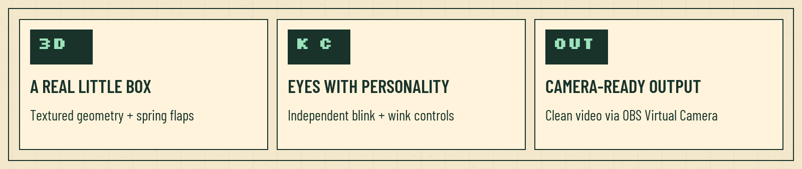
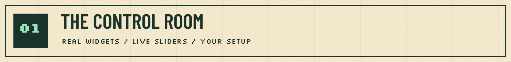
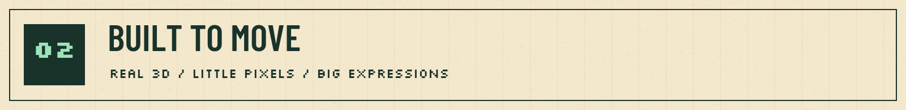
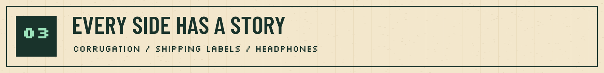
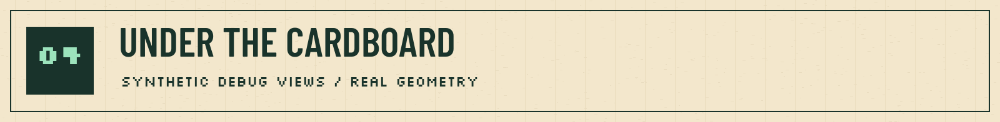
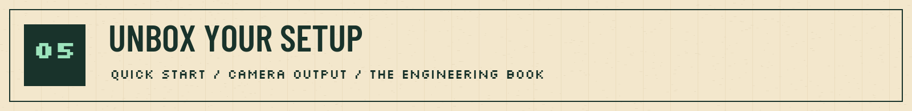
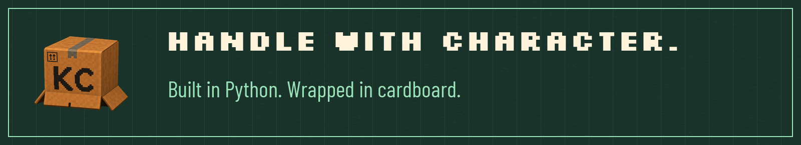

# KardboardCode Studio

[](docs/guides/getting-started.md)

*Official KC artwork, wrapped in pixel lettering and kraft-paper graphics.*

**A real 3D cardboard head for your real camera.**

[Get started](docs/guides/getting-started.md) ·
[Features & controls](docs/guides/features-and-controls.md) ·
[Camera setup](docs/guides/camera-and-virtual-output.md) ·
[Engineering book](docs/README.md) ·
[Release files](release/README.md)


*The real Windows Studio, running a labelled synthetic demo. No camera or video output.*

## Current milestone

**v1.0.0 — first official source release.** [What's included →](release/RELEASE_NOTES.md)



*Real geometry, live anatomical eyes, and clean output through the installed OBS camera component.*

## Inside the Studio



<table>
<tr>
<td width="50%" align="center">
<a href="docs/images/kardboardcode-studio-light.png"></a>
<sub>Same controls. A lighter workbench.</sub>
</td>
<td width="50%" align="center">
<a href="docs/images/kardboardcode-studio-native-camera.png"></a>
<sub>Your laptop camera, without memorizing device numbers. Illustrative names.</sub>
</td>
</tr>
<tr>
<td align="center">
<a href="docs/images/kardboardcode-studio-compact.png"></a>
<sub>A smaller desk. The same live eye controls.</sub>
</td>
<td align="center">
<a href="docs/images/kardboardcode-studio-tutorial.png"></a>
<sub>A built-in walkthrough, before you connect a camera.</sub>
</td>
</tr>
</table>

[Open the Studio tutorial →](docs/09-desktop-studio/tutorial.md)

## Cardboard in motion




*Recorded motion telemetry, rendered on a synthetic stage. No camera pixels in this GIF.*

<table>
<tr>
<td width="50%" align="center">

<sub>User-approved masked camera example.</sub>
</td>
<td width="50%" align="center">

<sub>The same performance, with person-segmentation green screen.</sub>
</td>
</tr>
</table>


*K follows your left eye. C follows your right.*

<table>
<tr>
<td width="50%" align="center">
<a href="docs/images/kardboardcode-flap-physics.png"></a>
<sub>Head turns tug at the spring-driven flaps.</sub>
</td>
<td width="50%" align="center">
<a href="docs/images/kardboardcode-flap-motion-sequence.png"></a>
<sub>Five moments. Independent little hinges.</sub>
</td>
</tr>
</table>

## Every side has a story




*The actual runtime character, rendered without camera imagery.*

<table>
<tr>
<td width="50%" align="center">
<a href="docs/images/kardboardcode-six-sides.png"></a>
<sub>A proper six-sided box, including its hollow underside.</sub>
</td>
<td width="50%" align="center">
<a href="docs/images/kardboardcode-angle-gallery.png"></a>
<sub>Nine angles. No cardboard-flat shortcuts.</sub>
</td>
</tr>
<tr>
<td align="center">
<a href="docs/images/kardboardcode-cinematic-poses.png"></a>
<sub>Small geometry. Plenty of attitude.</sub>
</td>
<td align="center">
<a href="docs/images/kardboardcode-performance-states.png"></a>
<sub>Blinks, winks and turns in combination.</sub>
</td>
</tr>
<tr>
<td align="center">
<a href="docs/images/kardboardcode-surface-tour.png"></a>
<sub>Tape, labels, corrugation, and a little wear.</sub>
</td>
<td align="center">
<a href="docs/images/kardboardcode-detail-views.png"></a>
<sub>Shipping marks and deliberately scruffy details.</sub>
</td>
</tr>
</table>

[Explore the avatar's visual design →](docs/02-architecture/textured-3d-renderer.md)

## Under the cardboard



<table>
<tr>
<td width="50%" align="center">
<a href="docs/images/kardboardcode-tracking-debug-window.png"></a>
<sub>Synthetic face mesh and XYZ diagnostics. No camera pixels.</sub>
</td>
<td width="50%" align="center">
<a href="docs/images/kardboardcode-render-mesh-debug.png"></a>
<sub>Real vertices, hinge groups and the internal privacy volume.</sub>
</td>
</tr>
</table>

<p align="center">
<a href="docs/images/kardboardcode-body-skeleton-debug-window.png"></a>
</p>

*A separate line-skeleton diagnostic—not a full-body avatar.*

## Unbox your setup



**Already installed?**

```powershell
.\.venv312\Scripts\kardboard-studio.exe
```

[Install & first launch](docs/guides/getting-started.md) ·
[All controls & CLI flags](docs/guides/features-and-controls.md) ·
[Phone / laptop / calling apps](docs/guides/camera-and-virtual-output.md) ·
[Troubleshooting](docs/guides/camera-and-virtual-output.md#troubleshooting-and-known-limits)

[Engineering book](docs/README.md) ·
[PDF handbook](docs/KardboardCode-VTuber-Engineering-Handbook.pdf) ·
[Original PNGTuber assets](assets/PNGTuberV1/README.md) ·
[Release package & notes](release/README.md)

*Source release, not an installer. Face-only loss freezes the last-safe frame; real calling-app
qualification remains unconfirmed. [Privacy and known limits →](docs/guides/camera-and-virtual-output.md#troubleshooting-and-known-limits)*



*Official supplied logo. Original banner compositions with licensed Silkscreen and Barlow
Condensed typography. [Artwork and font credits →](docs/branding/README.md)*
