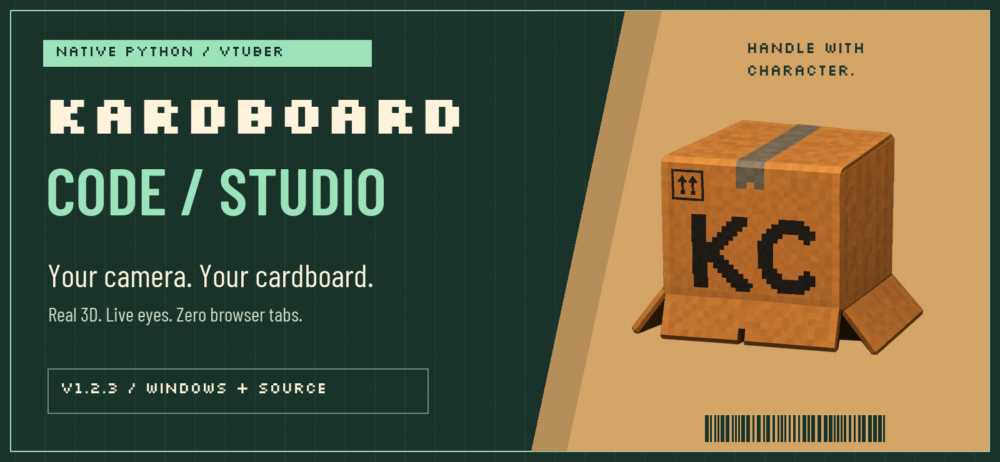
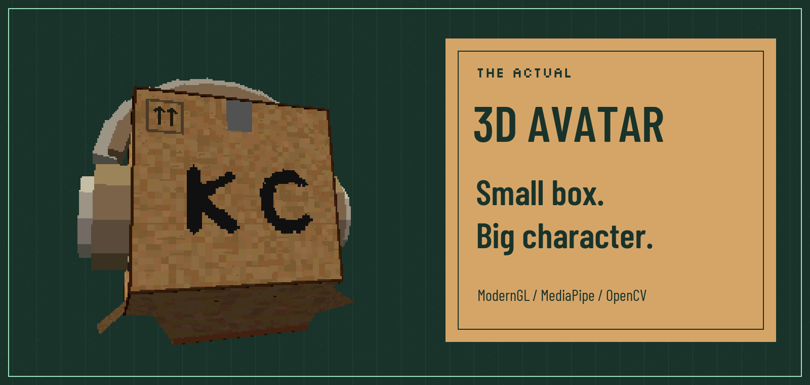
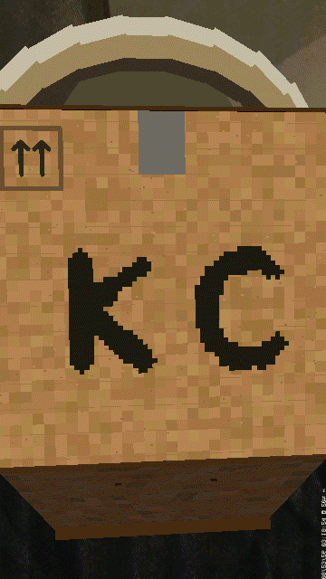
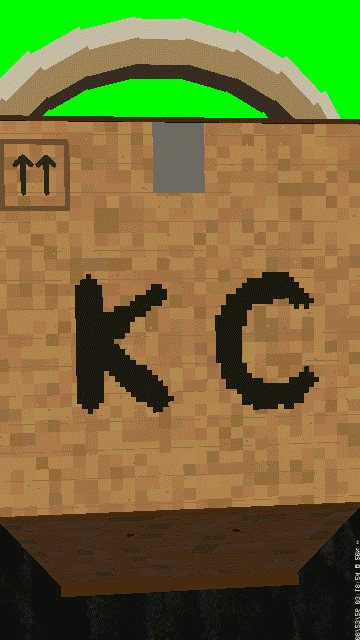
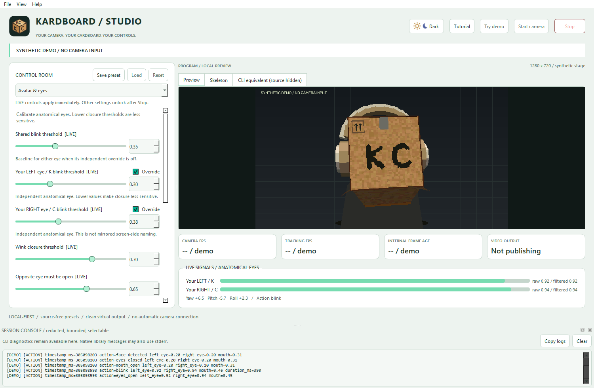

# KardboardCode Studio

*Recorded motion telemetry, rendered on a synthetic stage. No camera pixels in this GIF.*

*Left: user-approved masked camera example. Right: the same performance with person-segmentation green screen.*

**A real 3D cardboard head for your real camera.**

[Get started](docs/guides/getting-started.md) ·
[Windows setup](release/KardboardCode-Studio-windows-x64.msi) ·
[Full visual gallery](docs/visual-gallery.md) ·
[Engineering book](docs/README.md) ·
[Release files](release/README.md)

**v1.2.0 — More preview. Less clutter. Every option.** [What's included →](release/RELEASE_NOTES.md)

## Studio: dark and light

*Forest green, cardboard-brown controls. Actual Windows widgets on a synthetic, camera-free stage.*

*Warm paper, the same full-featured workbench. No camera input or published video.*

**[Explore the full gallery: Studio views, avatar details and diagnostics →](docs/visual-gallery.md)**

## Unbox your setup

[Download Windows setup](release/KardboardCode-Studio-windows-x64.msi), then open
**KardboardCode Studio** from Start. First launch offers verified component downloads; no Python setup.

[Source installation](docs/guides/getting-started.md) ·
[All controls](docs/guides/features-and-controls.md) ·
[Camera & output](docs/guides/camera-and-virtual-output.md) ·
[Artwork credits](docs/branding/README.md)

*Online, unsigned Windows x64 setup; source ZIP also available. Face-only loss freezes the
last-safe frame; real calling-app qualification remains unconfirmed.
[Privacy and known limits →](docs/guides/camera-and-virtual-output.md#troubleshooting-and-known-limits)*
