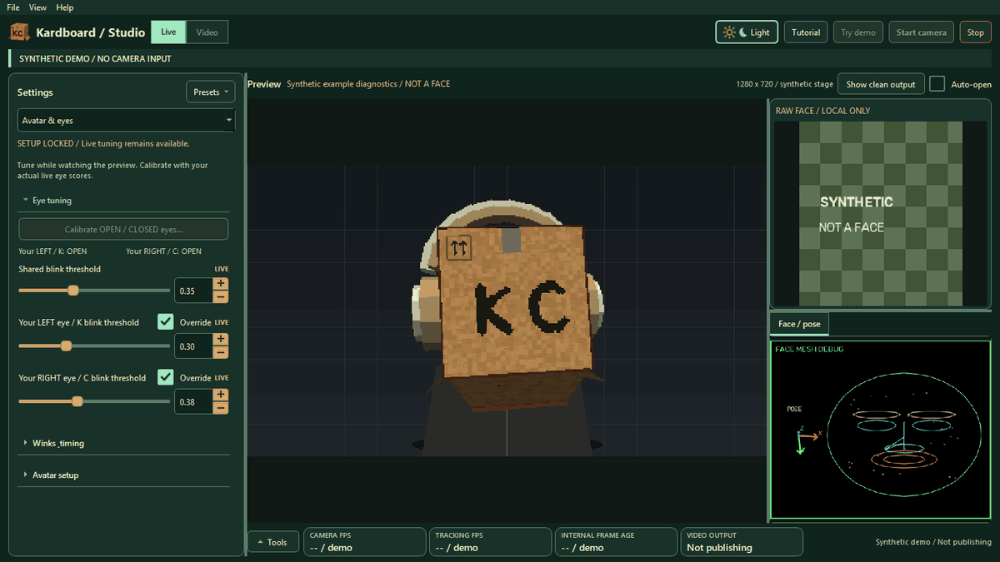
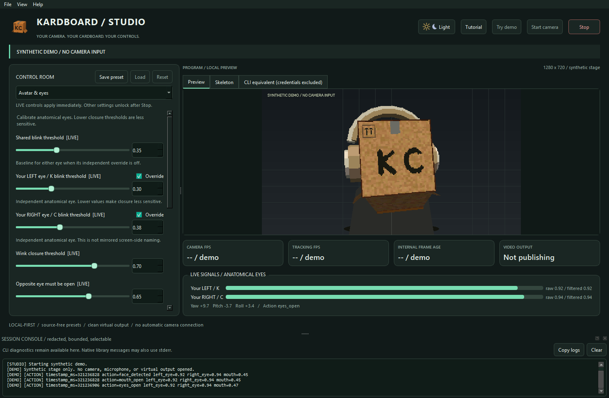

# KardboardCode Studio

*The current Studio in motion: dark, then light. Real native widgets and a synthetic demo; no camera capture.*

*Left: user-approved masked camera example. Right: the same performance with person-segmentation green screen.*

**A real 3D cardboard head for your real camera.**

[Get started](docs/guides/getting-started.md) ·
[Windows setup](release/KardboardCode-Studio-windows-x64.msi) ·
[Full visual gallery](docs/visual-gallery.md) ·
[Engineering book](docs/README.md) ·
[Release files](release/README.md)

**v1.2.4 — Padded controls. Verified feature coverage.** [What's included →](release/RELEASE_NOTES.md)

## Studio: dark and light

*Fresh native capture: moving synthetic preview, padded eye controls and the preferred data cards. Diagnostics are examples, not a face.*

*Fresh light-theme capture of the same 16:9 workbench. Show clean output stays accessible; all imagery is synthetic.*

**[More animations and views: themed Studio tours, avatar details and diagnostics →](docs/visual-gallery.md)**

**[Every GUI section and view in one offline HTML file →](docs/KardboardCode-Studio-GUI-Visual-Reference.html)**

*Download/open the HTML in a browser: indexed native screenshots in both themes, including scrolling sections and dialogs.*

## Unbox your setup

[Download Windows setup](release/KardboardCode-Studio-windows-x64.msi), then open
**KardboardCode Studio** from Start. First launch offers verified component downloads; no Python setup.

[Source installation](docs/guides/getting-started.md) ·
[All controls](docs/guides/features-and-controls.md) ·
[Camera & output](docs/guides/camera-and-virtual-output.md) ·
[Artwork credits](docs/branding/README.md)

*Online, unsigned Windows x64 setup; source ZIP also available. Face-only loss freezes the
last-safe frame; real calling-app qualification remains unconfirmed.
[Privacy and known limits →](docs/guides/camera-and-virtual-output.md#troubleshooting-and-known-limits)*
