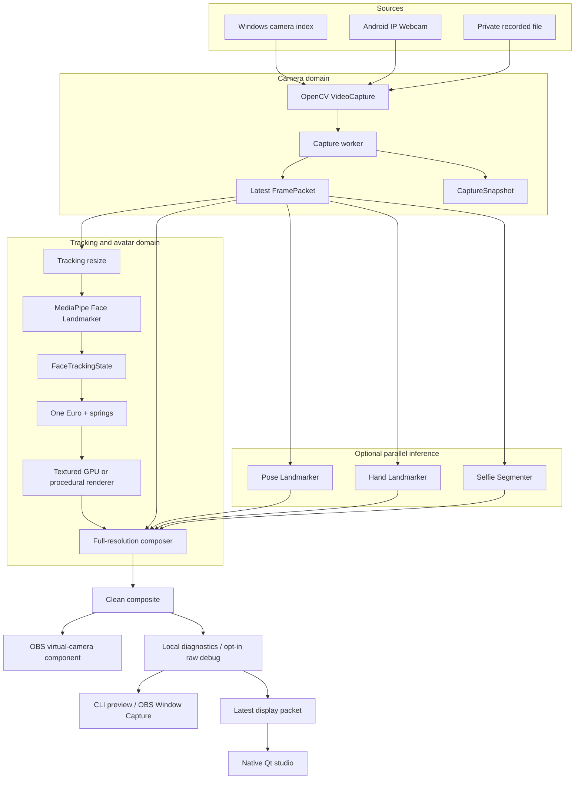
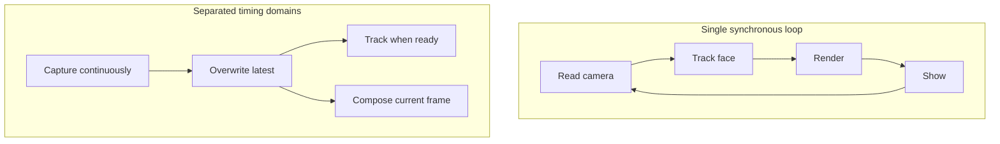
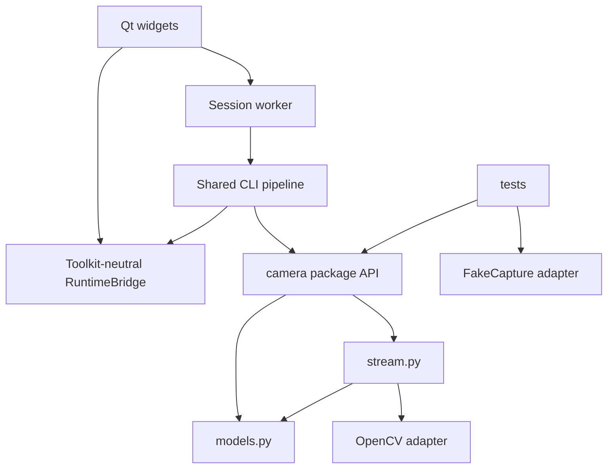

# System architecture

> **TL;DR** — Capture, tracking, rendering, composition, and presentation are separate stages with
> different performance characteristics. The system passes small contracts between stages rather
> than allowing one library to own the entire application.

## End-to-end runtime

## Component boundaries

### Configuration boundary

`CameraConfig` contains requested behavior. It validates impossible values early but never claims
that hardware accepted a request (`src/kardboard_vtuber/camera/models.py:90-121`).

### Capture boundary

`VideoCaptureLike` describes the OpenCV methods the worker needs
(`src/kardboard_vtuber/camera/stream.py:20-29`). This protocol is the seam used by tests.

### Concurrency boundary

`LatestFrameCamera` owns the thread, capture handle, condition variable, latest packet, counters, and
lifecycle (`src/kardboard_vtuber/camera/stream.py:39-73`).

### Presentation boundary

`cli.main` reads packets, submits optional asynchronous inference, resolves the head mode,
orders green-screen/head/hand composition, publishes the clean virtual output, and only then adds
local diagnostics. It does not implement capture or reconnection. Full-body diagnostics stay
separate rather than adding a filled body to the output.

The optional native studio calls this same pipeline from `SessionWorker.run`. `RuntimeBridge`
replaces HighGUI presentation with a one-slot owned preview and typed telemetry. Qt widgets and
painting stay on the main thread; native capture/tracking/rendering and the ModernGL lifecycle stay
off it. [Desktop runtime architecture](../09-desktop-studio/runtime-architecture.md) traces the
complete ownership, stop, error, and live-calibration contracts.

### Live calibration boundary

`tracking.eyes.EyeSensitivity` owns effective anatomical left/right thresholds. `LiveTuning`
atomically carries them and processing brightness to the worker. `FaceActionDetector.set_thresholds`
and both renderers' `set_eye_sensitivity` use the same validated snapshot, without rebuilding the
renderer or discarding its safe-frame hold. Raw action signals and filtered visual signals remain
distinct; the GUI displays both rather than inventing agreement.

## Why not one giant loop?

A synchronous loop makes camera ingestion wait for every expensive downstream stage. Separation
lets capture stay current even when inference or rendering slows down.

## Dependency direction

Higher-level code depends on project abstractions. OpenCV-specific constants are translated by
`CameraBackend.opencv_id` and `CameraRotation.opencv_code`
(`src/kardboard_vtuber/camera/models.py:15-48`).

## Stable extension seams

- Trackers consume transformed frame data, not `VideoCapture`.
- Renderers consume normalized project-owned tracking state, not raw MediaPipe objects.
- Compositors consume the current full frame plus project-owned masks or rendered overlays.
- OBS transport should consume composed output and remain independent of tracking.
- Native widgets consume owned display packets and send validated control snapshots, not mutable
  OpenCV/MediaPipe/ModernGL objects.

These seams are implemented in the camera, tracking, renderer, and CLI packages
(`src/kardboard_vtuber/tracking/models.py:15-100`,
`src/kardboard_vtuber/renderer/__init__.py:1`,
`src/kardboard_vtuber/tracking/green_screen.py:124-152`).

---

⬅️ [Architecture](README.md) · ➡️ [Data model](data-model.md)
