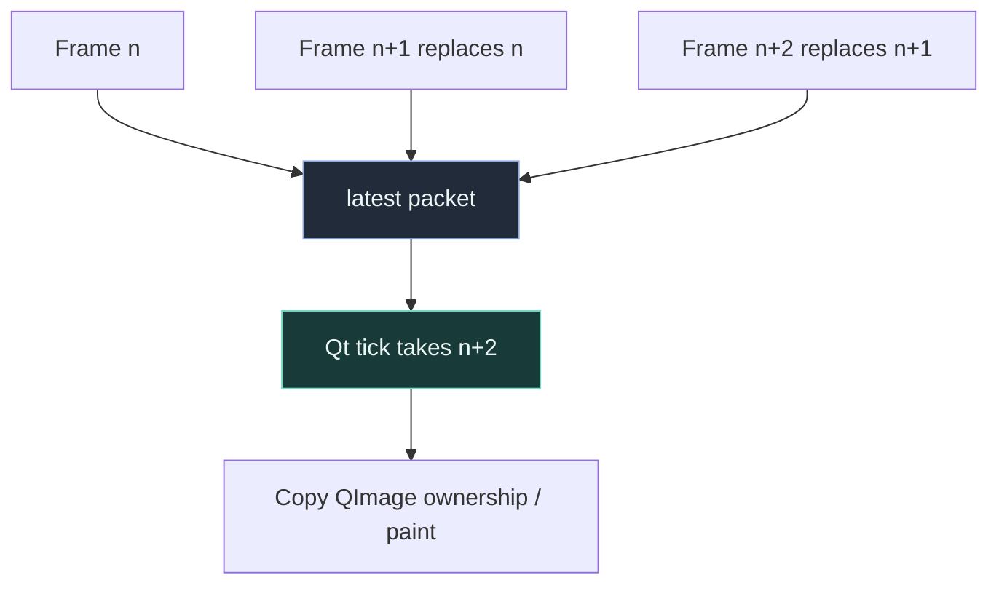

# Bounded studio mailbox

> **TL;DR:** The UI needs the newest preview, not every historical frame. A one-slot mailbox
> applies the same latency-over-completeness idea as camera ingestion at a second boundary.

## Problem

Suppose a producer renders 30 frames/s while a window temporarily paints at 10 frames/s.
An ordinary queued "frame ready" signal can accumulate 20 stale frames each second. Moving
rendering to a thread alone does not solve this backlog.

`RuntimeBridge.publish/take` stores one owned `PreviewPacket`. A publish replaces the waiting
packet; a UI timer takes the latest reference and clears the slot. Image resizing/copying happens
outside the short lock, so the widget does not hold a mutex during expensive pixel work.

## Complexity and boundaries

Slot replacement is O(1); copying costs O(source pixels + bounded diagnostic/display pixels)
when the full-resolution clean-window channel is present. A packet owns each channel separately:
program, clean window, raw face, mesh and skeleton cannot contaminate one another.
Waiting storage is one packet, not O(elapsed frames). Capture/virtual output keep independent
buffers. Dropping a display packet does not drop live output or an offline encoded video frame.

Logs use a separate 500-entry deque. When it overwrites older entries, the consumer receives an
explicit dropped-line count. The visible editor independently caps its text blocks at 1,500.
This keeps a slow consumer from producing invisible, unbounded operational history.

Live tuning is another immutable snapshot behind the same small lock. Validation occurs before
replacement, so a partially edited threshold tuple never reaches the worker.

Source: `src\kardboard_vtuber\runtime.py`, `RuntimeBridge`; UI consumer:
`gui\window.py`, `StudioWindow._poll_runtime`; pixel ownership: `gui\widgets.py`,
`VideoCanvas.set_frame`. Behavioral coverage: `tests\test_studio_runtime.py`,
`tests\test_studio_gui.py`.
