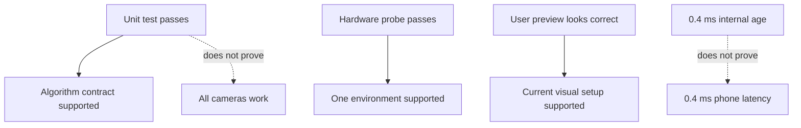
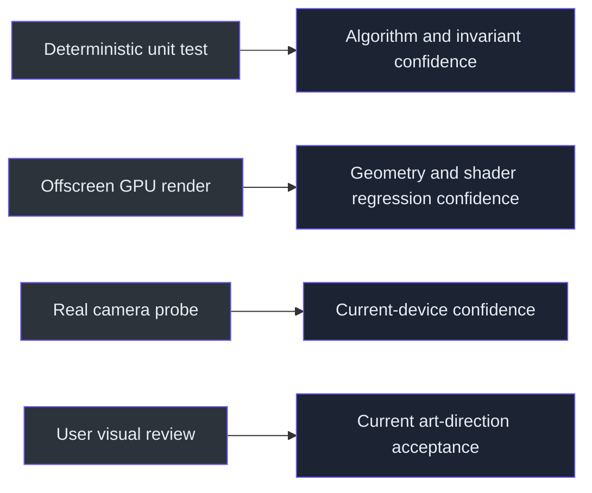

# Validation evidence and known limits

> **TL;DR** — Validation evidence is recorded with scope. A passing fake-capture test proves
> algorithm behavior; a five-second device probe proves only that device/backend combination at
> that moment.

## Evidence matrix

| Claim | Evidence | Confidence |
|---|---|---|
| Source parsing works | Unit tests | High |
| Credentials are redacted in diagnostics | Unit test + runtime output | High |
| Latest-frame overwrite occurs | Threaded fake test | High |
| Left rotation swaps dimensions | Unit test | High |
| Integrated camera works with `auto` | Runtime probe | Machine-specific |
| Phone `/video` works | Authenticated runtime probe | Current phone/network |
| Final portrait is upright | Temporary frame inspection + user preview | High for current placement |
| Phone preview is about 28-30 FPS | Runtime output and user screenshot | Current setup |
| Textured shell has six coherent sides and complete front | Geometry and render regression tests | High |
| Five flap hinges respond independently | Spring and renderer tests | High |
| Green screen hides the room before a fresh mask | Unit tests + recorded-frame validation | High |
| Tracking diagnostics are hidden by default | CLI tests | High |
| Positive box depth is not artificially capped | CLI and renderer tests | High |
| End-to-end latency is sub-millisecond | **Not established** | Do not claim |

## Why evidence scope matters

## Current gaps

- No long-duration soak test.
- No automated reconnect test with a failure-scripted fake.
- No end-to-end latency measurement using a visible timer or LED method.
- No CI workflow yet.
- No long-duration MediaPipe soak test yet.
- No committed pixel-for-pixel golden images; renderer assertions inspect geometry, masks, atlas
  regions, pixels, and measured motion instead.

## Recommended next quality work

1. Add scripted read failures and assert reconnect transitions.
2. Add tests for right and 180-degree rotations plus rotate-then-mirror ordering.
3. Add a 30-minute phone-stream soak tool.
4. Add Markdown link and Mermaid validation.
5. Add CI for Ruff, pytest, and documentation checks.

## Current automated coverage

The 2026-11-02 validated suite contains 266 tests spanning camera contracts and lifecycle, face-state
normalization and actions, One Euro filtering, spring integration, procedural and textured
renderers, experimental body tracking, hand occlusion, green-screen fail-closed behavior,
virtual output, native widgets, calibration, safe presets, bounded frame/log ownership, recorder
cancellation, branding assets, source-release integrity, frame-complete video export and CLI
compatibility (`tests/`).

## Desktop studio evidence - 2026-11-02

- Native camera selection is exercised through backend-specific metadata, strict inventory
  parsing, source/backend routing, mode switching, disappeared-device handling and a real
  asynchronous Windows inventory job. This machine returned Integrated Camera under MSMF and
  DirectShow and an OBS virtual-device entry. No camera streams were opened during these checks.

- The control-inventory test compares actual parser destinations against both declarative fields
  and constructed widgets: all 45 current camera options are represented.
- Live per-eye tests exercise both procedural and actual GPU expressions, retain safe loss holds,
  and prevent a fake blink across a configuration edit. Invalid edits retain the last valid tuple.
- Fake capture/tracker/output tests exercise the real CLI loop with GUI hooks, clean export before
  raw/debug overlays, stale-face freeze, no worker-thread signal/HighGUI calls, and partial-init cleanup.
  Cancellation during model initialization does not subsequently open capture or virtual output.
- Native widget tests cover camera-free startup, raw consent, source-free preset loading,
  tutorial navigation, live controls while running, heartbeat delivery, safe close/stop, detached
  QImage ownership, and an asynchronous offline model checksum verification.
- An actual offscreen GUI session replayed the private canonical recording with MediaPipe and
  the textured GPU renderer: 55 display packets, 54 effective detections, normal exit. No images
  were exported. These are integration counts, not a positioning/privacy accuracy score.
- `scripts\capture_studio_screenshots.py` captures real dark/light/compact/tutorial widgets and
  illustrative native-camera controls using only synthetic imagery. The screenshots are inspected
  before being linked from README.
- A six-second private-recording replay with the real GPU/MediaPipe pipeline delivered 117 GUI
  preview packets, 116 effective detections, and a successful live threshold edit. After a
  one-second warm-up following the first preview, 359 samples of a nominal 10 ms Qt heartbeat
  had a **31 ms 95th-percentile** interval and **47 ms maximum**. This measures service of the
  UI event loop on this machine, not input-to-photon or phone latency. Face inference used
  640-pixel input; higher-cost combinations still need their own qualification.
- An earlier separate screenshot run included initialization, theme swaps and widget/PNG capture and
  recorded a 375 ms maximum heartbeat interval. Do not present the steady replay measurement
  as a universal worst-case guarantee.

## Fifteen-point Studio feedback - v1.1.0

- GUI tests verify independent program/raw/mesh buffers and the full-resolution clean-window
  channel. The actual shared live loop exports before local diagnostics, including stale-face hold.
  Experimental body-calibration masks also omit setup text from Studio/virtual clean output.
- Native checkbox tests inspect real rendered indicator pixels in both palettes, not just
  stylesheet text. Locked/live state badges, standard resolution routing, bottom full-command copy,
  video mode and a real asynchronous file-export worker are exercised.
- Eye regressions cover the reported 0.51/0.66 closed-eye score pattern after explicit OPEN/CLOSED
  calibration, both procedural and actual GPU rendering, retained geometry filtering and rejected
  overlapping calibration ranges.
- Genuinely encoded synthetic VFR files verify every frame, unchanged source dimensions, exact
  lossless processed RGB pixels, source timestamp spacing and copied PCM/AAC packet payloads.
  MP4 remains explicitly lossy. Tests reject high-bit-depth conversion, clean cancellation and
  preserve outputs created by a concurrent writer.
- Actual synchronous MediaPipe VIDEO mode plus the GPU processed a private 30-frame recorded
  clip at 1080x1920, ending with face detection present. Temporary input/output slices were
  removed. No live camera opened and no private imagery entered public screenshots.
- Eight refreshed native screenshots use only synthetic imagery/illustrative paths. The
  diagnostic panel uses a visibly synthetic checkerboard, not a human face. Capture-run heartbeat
  maxima include initialization, layout/theme changes, PNG grabs and concurrent checks; they are
  not steady-state latency measurements or universal UI guarantees.
- A separate four-second native demo run, after warm-up, recorded 161 nominal-10ms heartbeat
  intervals: p95 31ms, maximum 32ms. These are local UI service intervals on this machine,
  not end-to-end video latency or a real-camera/all-feature performance guarantee.
- README milestone cards are absent; transparent section/footer SVGs contain font outlines
  without raster embedding or a canvas background. Desktop/mobile browser checks load every image
  without horizontal overflow, with the restyled runtime hero immediately after the top banner.

## First official release branding - 2026-11-02

- v1.0.0 adopts the supplied voxel KC box artwork; earlier v0.2.0 was unpublished local staging.
  The original 1345x1169 transparent PNG is retained byte-for-byte, not redrawn.
- Native Windows Qt decodes all seven derived ICO sizes from 16 through 256 pixels. Tests
  exercise transparent-color resampling, unchanged master bytes, repeatability and every
  embedded PNG frame. No extra image-processing dependency was introduced.
- Refreshed screenshots show the new header identity on actual widgets. The README retains
  one tool screenshot above Current milestone, with the separate official logo above it.
- Release checks cover source/version alignment, privacy exclusions, ZIP contents, checksums
  and Git-stored byte stability. These checks do not establish live calling-app compatibility.

The full suite and Ruff are reproducible with the existing commands in the
[command reference](../99-appendix/command-reference.md). GUI tests skip only when the optional
Qt dependency is not installed; install the GUI extra to include them. No live camera or real
Discord/Teams/Meet call was used to qualify this GUI delivery.

---

⬅️ [Quality chapter](README.md) · 🏠 [Book home](../README.md)
