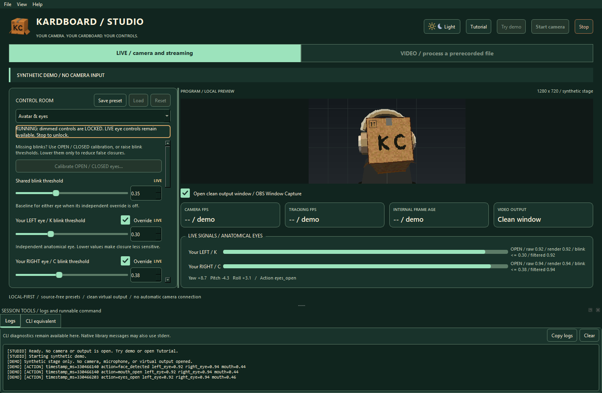
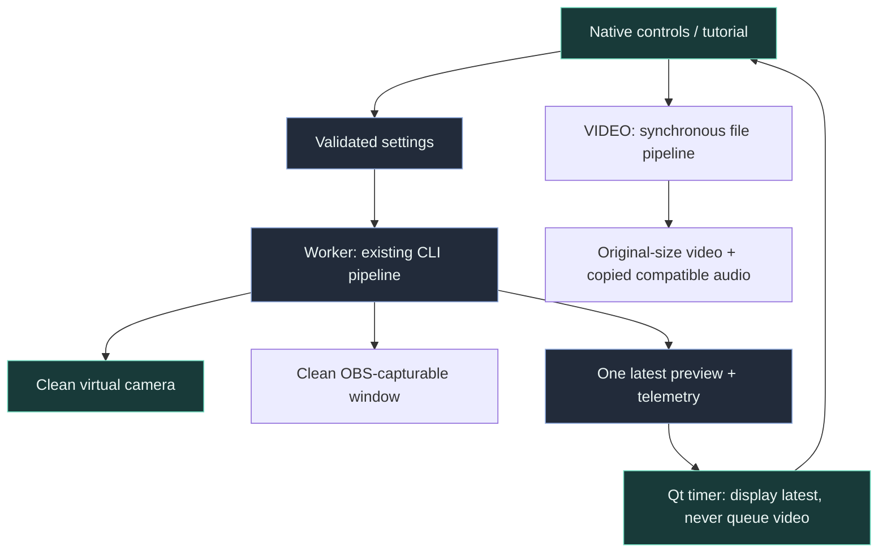

# Desktop Studio

> **TL;DR:** The desktop studio is an optional native PySide6 interface to the same camera
> live pipeline used by the CLI, plus a frame-complete offline VIDEO workspace. This chapter
> covers both workflows, separate clean output/diagnostics, calibration, ownership and evidence.

*Actual Qt widgets displaying the real textured renderer on a synthetic, camera-free stage.
The independent thresholds shown are illustrative demo settings, not recommended personal calibration.*

## Reading order

- [Research and design](research-and-design.md): five investigation lenses and toolkit decision.
- [Interface specification](interface-specification.md): every control and its placement rationale.
- [Runtime architecture](runtime-architecture.md): threading, ownership, errors, shutdown and calibration.
- [Video processing](video-processing.md): synchronous frames, lossless/lossy formats, timing/audio and safety.
- [Tutorial](tutorial.md): both modes, clean window, calibration, private capture and troubleshooting.

Research findings describe the pre-GUI source; implementation/evidence sections are updated as
work completes. Neither a synthetic screenshot nor a passing test establishes live camera privacy
or calling-app compatibility.
