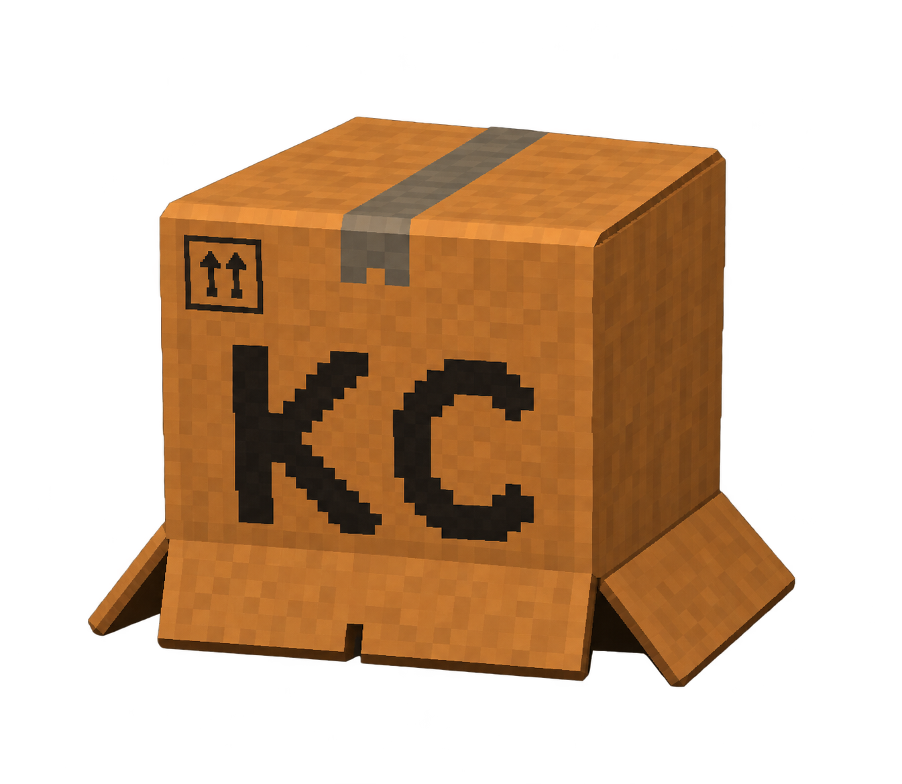

# Interface specification and placement rationale

> The first release exposes **all existing features**, including experimental flags and private
> recording, as requested. Face-only cardboard remains the default; visibility is not endorsement.

## Spatial model

The compact header contains identity, theme, tutorial, stable Start/Stop actions and two modes:
**LIVE** for cameras/streaming and **VIDEO** for applying the avatar to an existing file.
The owner's chosen arrangement is a scrollable settings inspector on the **left** and a large,
permanent preview directly beside it. Enabled visual diagnostics occupy a resizable **right-hand
column**: raw face above Face / pose or Body. Both image areas remain visible together, without
opening Tools; disabling their channels returns space to the main preview.
Labelled disclosure sections retain every option without expanding every form.
**Tools** / **Ctrl+J** opens a bounded bottom drawer containing **Logs**, **CLI equivalent**
and numeric **Signals**. The drawer starts closed, not the preview or selected diagnostics.

Why these positions:

- **Start/Stop stay in the header:** changing settings pages must not hide the emergency stop.
  Stop is visually distinct from Start, never a destructive "kill thread" action.
- **Source is first:** most startup failures are source/model/output setup, not eye calibration.
- **Avatar/eyes sit next to the preview:** the default Eye tuning section has calibration,
  shared/independent thresholds and compact anatomical OPEN/CLOSED readouts. Winks/timing and
  Avatar setup remain labelled expansions. Compare a left/right slider edit with the K/C result,
  using anatomical names rather than ambiguous mirrored screen-side labels.
- **Output is separate from input:** capture requests and virtual-camera dimensions are different
  contracts; changing one must not look like changing the other.
- **Experimental tracking gets its own page and warnings:** all features remain accessible without
  presenting hood/body estimates as the normal or privacy-certified path.
- **VIDEO is a front-level task:** its Video file inspector holds input/output files and quality.
  Progress stays beside the viewer even after changing inspector categories. File setup scrolls
  rather than pushing every other page below an unbounded form. The old raw recorder remains a consent-gated **Private capture**
  utility in Live mode, not the meaning of video processing.
- **Visual diagnostics need image area, not a text strip:** the owner's illustrated arrangement
  places raw face above tracking diagnostics to the right of the main preview. The main and
  diagnostic splitters cannot collapse; each requested image retains a real, fully visible
  canvas. Face / pose and Body share the lower tabs. Numeric signals remain in Tools.
  Raw/local-only warnings and the original start-time consent remain explicit.
- **Clean output is a persistent action:** **Show clean output** remains beside the Live preview
  and shares its View-menu action. Closing that separate window does not stop the worker or
  require restarting. **Auto-open** is a startup preference, independent of manual reopening.
  Idle opening is black/no capture; raw/headless/Video states cannot display clean output.
- **Model setup is discoverable:** missing files need actionable setup, not a cryptic traceback.
- **Tutorial is a persistent header action and a full page:** it is available before camera access,
  not a first-run modal that blocks the interface or disappears forever.
- **Logs remain selectable plain text:** no HTML interpretation, bounded history, explicit clearing
  and safe copying. Closing Tools does not stop log collection.
- **Presets are a menu:** Save/Load/Reset remain reachable in the inspector and File menu without
  a permanent row of three extra buttons. Load/Reset/model jobs visibly disable during work.
- **Errors do not consume the stage:** the bounded plain-text error surface remains visible and
  scrollable. Full details are retained rather than stretching an arbitrary-length message.

The viewer's splitter cannot collapse. Secondary tools have a height cap and a scrollable
content region, not a fixed height that can override the viewer's minimum. Native geometry
checks inspect ancestor clipping, including compact sizes, portrait/landscape frames, tools,
long errors, private diagnostics, video progress and explicit headless placeholders. Error
details can shrink within 48-68px; Tools can shrink below Qt's default scroll-area hint when
necessary. Neither may force diagnostic images outside their actual parent-clipped regions.

The default workbench uses a display-fitted **16:9** window (up to 1440 x 810 logical pixels),
with proportional down-sizing for the available work area. Resizing/maximizing remains native
and responsive. Empty space is not filled with additional permanent panels. The video itself
retains its source aspect ratio and original export dimensions; non-widescreen material is
fitted rather than stretched or cropped.

## Complete runtime control inventory

| Page | CLI fields / feature | Interaction |
|---|---|---|
| Camera | `source` | Computer-camera chooser with names/Refresh, or masked URL/file/manual-index entry |
| Camera | `backend`, `width`, `height`, `fps` | Choice and numeric requests; automatic values clearly labelled |
| Camera | `rotate`, `mirror`, `input_already_mirrored` | Rotation choice and separate checkboxes |
| Camera | `brightness` | Live internal-only slider with numeric value |
| Camera | `duration`, `preview_height`, `headless` | Optional duration, display-only height, preview suppression |
| Avatar / eyes | `render_cardboard`, `track_face`, `cardboard_renderer`, `physics` | Independent features and renderer selection |
| Avatar / eyes | `box_depth_offset` | Numeric perspective depth offset; no artificial positive cap |
| Avatar / eyes | `blink_threshold`, independent left/right overrides | Shared baseline plus live per-eye sliders/numeric editing |
| Avatar / eyes | `wink_threshold`, `eye_open_threshold`, `wink_min_difference` | Live calibrated controls with validation |
| Avatar / eyes | `action_hold_ms`, `eye_action_hold_ms` | Live debounce values |
| Avatar / eyes | `no_motion_filter` | Explicit smoothing toggle, restart-only |
| Output | `virtual_camera`, `virtual_camera_width`, `virtual_camera_height`, `virtual_camera_fps` | Enable, standard/monitor resolution preset and advertised FPS; width/height remain CLI fields |
| Output | `green_screen`, `segmentation_width`, `segmentation_model` | Feature toggle, input width, model file |
| Output | `hand_occlusion`, `hand_tracking_width`, `hand_model` | Anatomical foreground toggle, width, model file |
| Tracking labs | `full_body`, `pose_tracking_width`, `pose_model` | Separate skeleton diagnostics and pose configuration |
| Tracking labs | `body_head_fallback`, `hood_marker_tracking` | Explicit experimental toggles; reject their invalid combination |
| Tracking labs | `tracking_debug`, `debug_face_preview` | Local diagnostics and explicit raw-face consent |
| Models | `face_model`, optional model paths | Browse fields, existence indicators and checksum-verifying download actions |

The new independent-eye CLI overrides preserve the original shared `--blink-threshold` default.
They do not change anatomical K-left/C-right mapping.

## Video processing and private capture

VIDEO offers a local input, a new output filename, lossless FFV1/MKV by default and explicitly
lossy H.264/MP4 CRF 17. It processes every frame, retains source dimensions and timestamp
spacing within container precision, and copies compatible audio streams. Live camera transforms,
virtual output and experimental body/marker modes are visibly unavailable. Every processing
setting locks during export for a deterministic result. See [video processing](video-processing.md).

Source/backend/rotation/mirror/brightness and face/pose model selections are reused from the
current setup. The advanced private-capture page exposes `full_body`, `free_recording`, `duration`, `tracking_width`,
`pose_tracking_width`, `pose_tracking_fps`, `output_dir`, `name`, `countdown`, and `preview_height`.
These map to `scripts\record_guided_regression.py`, not to an invented output format.

Recording is mutually exclusive with the GUI's live/demo pipeline. Its raw preview remains the
existing recorder window; the native studio remains available for logs and lifecycle control.
The interface does not silently record the safe preview instead of the documented raw regression data.

## State and validation

- Opening: no source connection, no output, no raw consent. Synthetic demo is explicit.
- Starting: disable duplicate starts, show initialization, retain Stop.
- Running: enable live tuning; restart-only settings show **LOCKED / STOP TO EDIT**, muted fields
  and a persistent explanation. Offline-only/live-only controls state their scope.
- Stopping: request cooperative shutdown; keep the window event loop running.
- Stopped/error: clear live video to an explicit idle/error state, release owned resources, enable setup.
- Invalid tuning: show the exact invariant; retain the last applied valid snapshot.
- Raw debug or unmasked-camera mode: acknowledgement before a real camera run, never stored in presets.
- Imported preset: source excluded; raw-preview consent always resets off.

## Tutorial requirements

The in-app guide must explain first launch/model setup, source input, transformations, safe preview,
anatomical eye calibration, live/restart badges, virtual-camera selection/single-producer constraints,
green screen/hands, experimental tracking, recording privacy, source-free presets, logs, and Stop.
The same narrative must be readable in [the book tutorial](tutorial.md).

## Calibration and capture routes

Guided calibration samples relaxed OPEN eyes, then BOTH CLOSED eyes after a countdown.
Only numeric observations are retained. The complete compatible threshold tuple applies atomically;
overlapping samples fail visibly. Higher blink thresholds help missed closures; lower thresholds
reduce false closures. The readout shows raw score, effective rendered score and CLOSED/OPEN.

Device index 0 means the first device for an API. Media Foundation and DirectShow are capture
backends, often exposing the same integrated camera, not an RGB/IR pair. No physical-device
identity is inferred from equal names. The current automatic/manual route remains explicit.

## Visual identity

Both themes follow the top banner: forest ink, mint, kraft and cream. The dark theme uses forest
surfaces; the light theme uses warm paper. Checked boxes have an explicit contrasting tick;
unchecked boxes are empty bordered squares, and disabled states remain distinguishable.
Dark slider handles and filled tracks use cardboard brown (`#d5a568`) so frequently touched
controls echo the box material. Mint remains reserved for checked/live/primary states rather
than making every accent brown. Light sliders retain their deeper green for contrast on cream.
Video pixels are never recolored by the UI. The theme button includes both a sun and a moon icon.
The window/application/header icon uses the user's supplied voxel **KC cardboard-box artwork**.

Numeric controls show an explicit **+** above **-** on contrasting step-button surfaces.
They increase/decrease the current value by its existing step; direct typing and arrow keys
remain available. Disabled and boundary-unavailable steps use muted symbols. Vector glyphs
are specified explicitly because a native button-symbol setting alone did not paint reliably
through the custom Qt stylesheet. The Live/Video strip does not draw Qt's extra trailing baseline.
Its canonical PNG stays unchanged; optical bounds discard near-invisible outer noise in derived
icons, which fill their small native slots. Windows controls the title-bar/taskbar slot size.
Actual screenshots must be generated from the running widgets, not a design mockup.

*Official tool identity for the first official release, v1.0.0. This supplied artwork replaces
the earlier hand-authored SVG icon; it does not replace or modify the tracked 3D avatar.*
