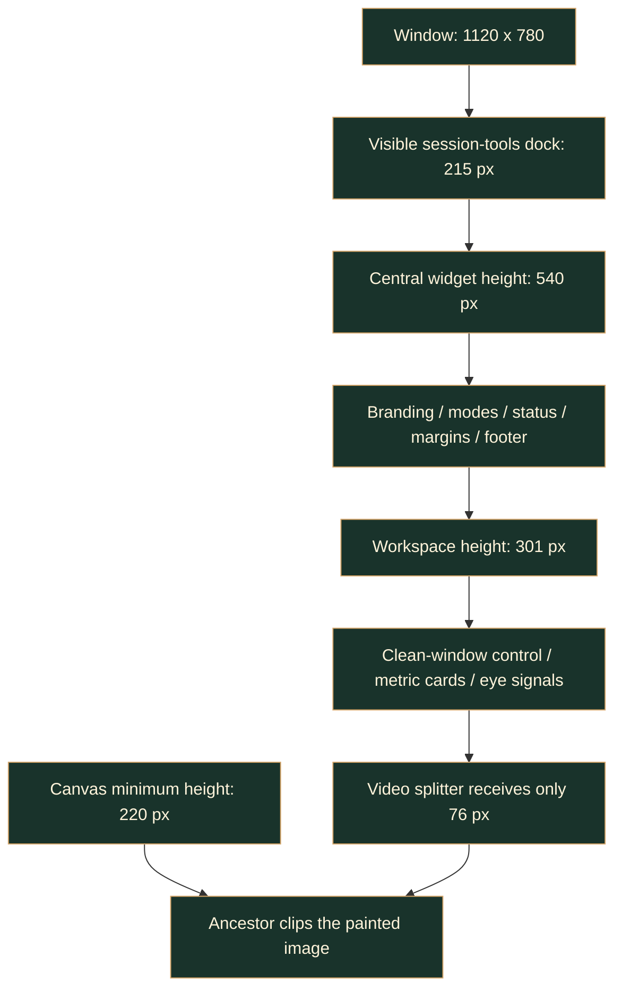

# Desktop GUI research and design

> Research date: 2026-11-02. Scope: a native, responsive, all-feature Python studio that retains
> the existing CLI and its privacy/output semantics. The user explicitly requested a tutorial.
> Confidence labels describe the evidence, not an assertion that the delivered GUI is fast.

## Iteration 1 - Structural survey

**HIGH, source-confirmed:** `cli.build_parser` owns the operational flags
(`src\kardboard_vtuber\cli.py:35-285` at research time). `cli.main` constructs tracking,
renderer and output resources, then performs a continuous capture/composition loop
(`cli.py:288-630`). The GUI must not run this loop on the widget thread.

**HIGH:** There are already two expression consumers: `FaceActionDetector._classify_eyes`
(`tracking\events.py`) and each renderer's eye logic (`renderer\ps1_cardboard.py`,
`renderer\textured_3d.py`). A slider connected only to the detector would change logs while
leaving the visible K/C expression unchanged. This is the most important calibration trap.

**HIGH:** Model downloads and guided/free regression recording are separate scripts
(`scripts\download_*_model.py`, `scripts\record_guided_regression.py:113-203`).
An all-feature GUI must expose these too, rather than equating "all" with camera preview.

**Next lens:** trace pixel, control, and telemetry ownership through the loop.

## Iteration 2 - Data flow and state

**HIGH:** The source camera and the adjusted tracking image are deliberately separate.
`cli.main` makes the brightness-adjusted processing frame before tracker submission but
starts composition from the original packet copy (`cli.py:431-465,500-548` at research time).
The GUI's brightness slider must retain this distinction.

**HIGH:** Virtual-camera output precedes local diagnostics and raw-face preview
(`cli.py:547-599`). `VirtualCameraOutput.send/repeat` owns the repeated output buffer
(`virtual_camera.py:68-104`). A GUI cannot forward a widget screenshot to virtual output.

**HIGH:** `LatestFrameCamera.read` waits on a condition and returns the newest packet;
`stop` joins the capture thread with a timeout (`camera\stream.py:99-143`).
Closing a window cannot synchronously wait for this on the event thread.

**Decision / engineering inference:** use one immutable live-settings snapshot and one latest
preview mailbox, plus a bounded log ring. The UI polls this mailbox at approximately 30 Hz.
This intentionally drops superseded previews; the sender still receives its own full-size
clean frames. Boundedness is established structurally; achieved responsiveness needs measurement.

**Next lens:** compare toolkit integration and dependency costs.

## Iteration 3 - Toolkit and external contracts

| Candidate | Verified capabilities | Project-specific tradeoff |
|---|---|---|
| PySide6 / Qt Widgets | Native widgets, layouts, accessibility/keyboard controls, timers, threads, image buffers, dialogs | Extra binary dependency; thread affinity must be respected; distribution licensing needs review |
| Tk/ttk | Standard Python GUI interface, themed controls, native dialogs, event-loop model | Viable smaller UI; richer split layouts, calibration controls, image display and styling require more project-owned work |
| Dear PyGui | GPU-driven UI and explicit render loop | Strong tool/debug UI; introduces a second graphics/render-loop abstraction beside ModernGL; not evidence of faster end-to-end video |

Primary sources, read on the research date:

1. [Qt QThread](https://doc.qt.io/qtforpython-6/PySide6/QtCore/QThread.html):
   a `QThread` object lives in its creator thread; `run()` executes separately. Queued
   slots on a subclass are not automatically worker-thread commands. Forced termination is discouraged.
2. [Qt QTimer](https://doc.qt.io/qtforpython-6/PySide6/QtCore/QTimer.html):
   timers belong to their event-loop thread; deadlines can slip under load. A nominal 33 ms
   timer does not guarantee 30 displayed frames per second.
3. [Qt QImage](https://doc.qt.io/qtforpython-6/PySide6/QtGui/QImage.html):
   direct pixel access and image ownership differ from screen-oriented QPixmap.
4. [Qt QPlainTextEdit](https://doc.qt.io/qtforpython-6/PySide6/QtWidgets/QPlainTextEdit.html):
   simplified layout and `maximumBlockCount` suit a bounded plain-text log.
5. [Python Tkinter](https://docs.python.org/3/library/tkinter.html):
   Tcl/Tk event queues and threading rules still require work outside the event callback.
6. [Dear PyGui render loop](https://dearpygui.readthedocs.io/en/latest/documentation/render-loop.html):
   expensive work in the render loop reduces UI frame rate.
7. [Qt for Python licensing](https://doc.qt.io/qtforpython-6/commercial/index.html):
   community and commercial distributions have different licensing terms. Adding the
   community dependency is not a legal determination about a future packaged distribution.

**Decision:** optional `PySide6-Essentials` (QtCore/QtGui/QtWidgets and image/icon loading),
not a browser server and not a mandatory CLI dependency. Widgets provide the
sliders, numeric editing, splitter, logs, dialogs and tutorial without an HTML bridge or
per-frame JavaScript encoding. This is a fit decision, not an unmeasured speed ranking.

**Next lens:** failure containment, interaction risks, and maintainability.

## Iteration 4 - Patterns, risks, and anti-patterns

**Avoid a second pipeline:** reuse `cli.main` through optional runtime hooks. Keep ordinary
CLI behavior when hooks are absent. Do not copy segmentation, hand restoration, freeze,
fallback resolution or clean-export ordering into a separate Qt compositor.

**Avoid one queued signal per frame:** even a responsive producer can accumulate stale events
in a slow UI. Publish only the latest resized preview. Copy the QImage before the NumPy owner
can be replaced. Bound worker logs and displayed text independently.

**Avoid implicit capture:** opening the GUI, loading a preset or opening a tutorial must not
start a camera. The demo must use synthetic imagery and say so visibly.

**Avoid hidden live/restart mismatch:** independent eye thresholds and internal brightness
are live. Resource topology, source, resolution, models, mirroring, output format and tracking
modes are restart settings. Keep live widgets enabled during work; lock or clearly mark
restart-only settings instead of silently deferring them.

**Avoid unsafe persistence:** source URLs and raw-preview consent are session-only. Save only
an allowlisted settings schema. Imported presets are data, not commands; do not evaluate
arbitrary Python or spawn an imported command. Commands/logs redact URLs before display/export.

**Keep known limitations visible:** body/hood modes are experimental; no-face/no-marker does
not prove rear orientation. Raw debug/recordings are privacy-breaking local operations.
The existing fixed-FPS recorder's elapsed-time limitation is not resolved by adding a button.

**Remaining qualification:** native camera-driver stop latency, high-DPI appearance on other
monitors, actual calling apps, and difficult distant-face lighting need owner-environment evidence.

## Iteration 5 - Synthesis

Think of the studio as a control surface beside the existing machine, not a replacement machine.
Qt owns interaction and display. The worker owns capture orchestration, inference consumers,
the OpenGL context, composition, and camera delivery.

What that mental model hides: MediaPipe and OpenCV already have their own asynchronous/native
work; a Python thread is not process-level crash isolation. A stuck native driver cannot be
made safely cancellable by `QThread.terminate`. During shutdown the window must remain responsive
and honestly show "Stopping" rather than destroy the thread or claim resources are released.

Key findings:

1. **HIGH:** tuning must reach both actions and rendering, not only logs
   (`FaceActionDetector`, `PS1CardboardRenderer`, `Textured3DCardboardRenderer`).
2. **HIGH:** export-before-debug is a required privacy boundary (`cli.main`,
   `VirtualCameraOutput`), independent of the UI layout.
3. **HIGH:** all-feature coverage includes the recorder/model scripts, not just parser flags.
4. **Design decision:** progressive disclosure by task keeps the default face-only workflow
   obvious without removing advanced flags requested by the user.
5. **Design decision:** a fixed-location Stop button, explicit raw consent, named anatomical
   eyes and nearby live meters reduce operational ambiguity.
6. **Unknown until measured:** actual UI heartbeat under inference, platform-specific widget
   sizing, and native-runtime cleanup. Tests/screenshots must record evidence, not aspirations.

## Knowledge map after research

- **Explored:** parser, main loop, per-eye consumers, frame ownership, native toolkit contracts,
  recorder interface, capture stop, export ordering, documentation structure.
- **Partially explored:** native-driver cancellation and distribution packaging; no universal
  camera cancellation or installer behavior is claimed.
- **Unexplored / deliberately deferred:** alternate inference engines, new body-tracking fixes,
  a separately named Windows camera driver, and changes to recording timing.
- **Implementation direction:** one bounded runtime bridge, shared eye tuning, native widget
  controls, optional GUI extra, source-free presets, explicit private recording, and a synthetic
  demo/tutorial that works without a camera.

---

## 2026-11-03 revision: preview-first, not dashboard-first

The user reported that the preview disappears into a strip and that the Studio is too busy,
while explicitly requiring access to every option. This investigation starts from `5dcf3db`
and the v1.1.1 application, not the pre-GUI implementation studied above.

**Status:** research completed; the owner chose the left inspector/right preview and the
structure is implemented for v1.2.0. The five iterations below preserve the original diagnosis
and proposal. Geometry and option-access evidence is not owner visual/usability approval.
No camera, microphone, virtual output, system display setting or existing user process was used.

### Iteration 1 - Reproduce the actual space failure

**HIGH, source-confirmed:** `_build_ui` puts branding, subtitle, work modes, status, settings/
workspace splitter and footer into the central vertical layout. `_build_workspace` then stacks
the video splitter, clean-window control, four metric cards and eye/pose signals.
`_build_console` adds a visible bottom dock outside that central layout. These regions all
compete for the same window height
(`gui\window.py:126-257,759-911`).

**HIGH, measured on this machine:** an owned Windows/Fusion synthetic demo reproduces the
supplied screenshot. The canvas remains 220 pixels tall, but its parent splitter is only
76 pixels tall. The parent clips the image; `isVisible()` alone cannot establish that the
whole image is visible. `VideoCanvas.paintEvent` already uses aspect-fit drawing, so changing
that to another fit mode would not fix this ancestor-layout defect
(`gui\widgets.py:219-263`).

| Native audit case, 100% Qt scale | Window | Layout minimum-height hint | Visible canvas height | Whole paint target visible |
|---|---|---|---|---|
| Live, tools open | 1120 x 780 | 960 | 76 of 220 | No |
| Live, tools open | 1280 x 720 | 960 | 52 of 220 | No |
| Live, tools open | 1500 x 980 | 960 | 212 of 220 | No |
| Live, tools closed | 1120 x 780 | 739 | 233 of 233 | Yes |
| Video setup, tools open | 1120 x 780 | 990 | 94 of 220 | No |
| Video setup, tools closed | 1120 x 780 | 769 | 296 of 296 | Yes |

The bottom dock occupies **215 pixels**, despite the requested `resizeDocks(...,155,...)`.
That request is not a guaranteed height budget. The main window's explicit minimum is
1080 x 720, below the measured layout requirement (`window.py:84,910`).

**HIGH, documented and reproduced:** `QSplitter` children are collapsible by default, even
with a nonzero minimum size. With the empty diagnostic panels shown, allocating
`[230,0,260]` gives the preview zero splitter allocation. A protected preview therefore needs
both a valid parent space budget and an explicit non-collapse policy
(`window.py:803-812`; [Qt splitter contract][clarity-qt-splitter]).

Eight geometry scenarios were repeated at Qt scale factors **1.0, 1.25 and 1.5**: 24
observations, not 24 passing usability tests. The 1120 x 780 live case retained only
76 visible canvas pixels at each scale. At higher scales the OS also reduced a requested
large window's height to fit the work area. These are isolated process-scale experiments
on one Windows machine, not qualification of every display or mixed-DPI monitor setup.

**Next lens:** preserve the interaction and pixel contracts while relocating their widgets.

### Iteration 2 - Separate tasks without breaking their shared state

**HIGH, source-confirmed and inventory-checked:** all 45 camera-runtime parser options map
exactly once to the declarative field inventory; nine support live edits
(`gui\settings.py:18-176,186-240`).

| Current group | Runtime options | Proposed treatment |
|---|---|---|
| Camera | 13 | Input and transformations; secondary capture controls in labelled sections |
| Avatar & eyes | 14 | Keep avatar configuration and live eye tuning together with the preview |
| Output & effects | 8 | Preserve standard resolution choices, output route and effect controls |
| Tracking labs | 6 | Explicit experimental/diagnostic area, not default dashboard furniture |
| Models | 4 | Keep each model destination and explicit verify/download action |

The preservation inventory also includes GUI-only native-camera selection, video input/output/
quality/progress, source-free presets, private recording, tutorial, themes, logs, command copying
and clean output. Counting parser options alone would miss those
(`window.py:397-473,640-758,866-1019,1379-1545`).

**HIGH:** control edits flow through `OptionControl.changed`, `_refresh_settings`,
`settings.namespace` and the existing atomic tuning snapshot. Changing the selected settings
group must not recreate controls, discard edits, open a camera or restart the worker
(`gui\widgets.py:62-154`; `window.py:1021-1057`; `runtime.py:108-115`).

**HIGH:** the mailbox already separates program, clean, raw-face, mesh and skeleton channels.
The layout should consume those existing channels rather than make a second compositor.
The clean OBS-capturable window remains separate and cannot be replaced by a screenshot of
the newly rearranged Studio
(`runtime.py:80-153`; `window.py:1267-1297`; `gui\output.py:11-31`).

**Important exception:** "preview always visible" means the workspace and its full fitted image
must not be accidentally clipped. The explicit `headless` option still intentionally suppresses
frames; it should leave a clear explanatory placeholder, not be silently overridden or removed
(`settings.py:76-82`; `gui\worker.py:116-122`).

**Next lens:** distinguish native layout guarantees from general usability guidance.

### Iteration 3 - Primary research and platform contracts

**HIGH for the published guidance; application below is a design inference:**

1. **Progressive disclosure, not feature removal.** NN/g recommends showing the important
   starting controls and revealing secondary detail through obvious, accurately labelled
   controls. It warns against excessive disclosure depth. Its distinction between progressive
   and staged disclosure matters here: eye tuning and seeing its result are interdependent,
   so a setup wizard that replaces the preview would be a poor fit
   ([Progressive Disclosure][clarity-disclosure]).
2. **Minimalist means sufficient, not empty.** NN/g explicitly distinguishes reducing visual
   noise from removing necessary functionality. Keep the requested features and their labels;
   remove redundant framing, repeated explanations and permanently expanded technical readouts
   ([Aesthetic and Minimalist Design][clarity-minimalism]).
3. **Status and recovery remain discoverable.** State, Stop, raw/private warnings, export
   progress and actionable errors must not disappear into a closed tools drawer. This follows
   status visibility, user control, recognition and error-recovery principles
   ([Nielsen's heuristics][clarity-heuristics]).
4. **Use hierarchy rather than tiny typography.** Microsoft describes consistent spacing,
   gutters and type hierarchy as ways to group controls. It also recommends responsive
   repositioning, reflow and selective metadata disclosure. Those principles apply to this
   Qt application; the WinUI-specific controls and example pixel values are not a requirement
   to migrate toolkits
   ([Content layout][clarity-spacing]; [Responsive design][clarity-responsive]).
5. **Protect the actual content region.** Qt distinguishes a central widget from surrounding
   secondary docks. Its dock documentation says size policies and constraints belong on the
   dock's child content. The splitter contract separately requires preventing collapse.
   Merely increasing `VideoCanvas.minimumHeight` or calling `resizeDocks` again is insufficient
   ([Main window][clarity-qt-main]; [Dock content][clarity-qt-dock];
   [Splitter][clarity-qt-splitter]).
6. **Compress application chrome before the work.** Microsoft's app-silhouette examples
   include placing navigation and commands on the same row to retain vertical content space.
   This supports a compact toolbar instead of a marketing-sized title/subtitle stack
   ([App silhouettes][clarity-silhouette]).

No click-frequency telemetry or observational owner study was collected. The priority of the
preview comes directly from the user's request; further decisions about commonly used settings
remain proposals rather than invented usage statistics.

**Next lens:** compare complete workspace patterns instead of copying attractive screenshots.

### Iteration 4 - Pattern comparison and failure risks

The official OBS overview demonstrates separate settings categories and simple/advanced output
configuration. Kdenlive documents task-specific workspaces and distinct monitor widgets. These
are useful reference patterns, not proof that their full interfaces should be copied or that
their previews can never be hidden
([OBS overview][clarity-obs]; [Kdenlive workspaces][clarity-kdenlive];
[Kdenlive monitors][clarity-monitors]).

| Candidate | Fit to this request | Main risk |
|---|---|---|
| Keep dashboard, only close logs | Recovers space in the measured case | Cards, signals, diagnostics and video form still compete; not a full redesign |
| Permanent viewer + one inspector + optional tools | Recommended | Needs explicit size budgets and a complete option-access audit |
| Full-window settings tabs or setup wizard | Reject as the main interaction | Replaces the preview precisely when tuning needs it |
| Mandatory separate settings windows | Not the default recommendation | Window management and focus become part of every adjustment |
| Make every panel freely dockable | Not required for the initial redesign | Adds layout states and ways to crowd out the viewer |

**MEDIUM, design recommendation:** use familiar task names and at most one secondary disclosure
inside a selected inspector group. Do not put everything into an unlabelled "More" menu, replace
labels with unexplained icons or require three nested expansion steps to reach a normal setting.
Eye calibration and its basic threshold controls should stay close to their numeric observations;
raw/filtered/pose expert detail can live in an expanded signals section.

**HIGH, source-confirmed risk:** packets currently show/hide raw and diagnostic panels
automatically. That changes the central horizontal splitter's available width. In the redesign,
diagnostics need a bounded secondary region rather than competing as additional main-canvas
columns. Their enabled/private state still needs an obvious indicator
(`window.py:1267-1297`; `runtime.py:123-139`).

Other non-negotiable constraints: preserve contrasting checked/disabled/focus states, brown dark
sliders, sun/moon theme icons, source redaction, raw consent, live/restart locking, model actions,
anatomical K/C naming and all existing clean-output boundaries
(`gui\theme.py:49-164`; `widgets.py:139-154`; `window.py:1098-1136,1197-1250`).

**Next lens:** choose a structure and measurable acceptance criteria, then seek owner review.

### Iteration 5 - Recommended structure and implementation gate

Think of the Studio as **a video workspace with tools beside it**, not a dashboard containing
a small video widget. The viewer stays in place while one contextual inspector changes.
Logs, command text and detailed diagnostics are available on request rather than permanently
occupying the same visual rank as the avatar.

What this model hides: users still need clear controls for unavailable/live-only settings,
privacy warnings cannot be progressively hidden, a closed drawer must not stop log collection,
and explicit headless mode remains an intentional exception to frame display. Qt's minimum
sizes, parent geometry and high-DPI work area still have to be tested together.

**Recommended layout, pending owner choice:**

- One compact top toolbar: small KC identity, Live/Video selection, primary action and fixed Stop.
  Theme and tutorial remain easy to reach; presets become a labelled menu instead of three
  permanent buttons in the settings heading.
- A protected, expanding, aspect-fit preview as the dominant work area. No diagnostics or
  floating helper text over its pixels; no splitter allocation of zero.
- One scrollable inspector beside it, with familiar task categories. Video file setup belongs
  in that inspector, not above every settings page outside the scrollable region.
- Group routine eye controls together; put extra wink/debounce detail behind a labelled
  advanced section. Preserve the underlying option values and command/preset schema.
- A compact status/output strip. Keep the clean-output action discoverable and distinguish it
  from OBS Virtual Camera. Move the four large metric cards and always-open eye/pose block
  out of the default central layout.
- A closed-by-default, height-bounded tools drawer with Logs, CLI and Diagnostics tabs.
  Opening it must resize the viewer safely, not cover or clip it. Errors and export progress
  remain visible outside the drawer.
- Fewer nested borders and uppercase headings; consistent spacing and a restrained type
  hierarchy. Preserve the forest/mint and kraft/cream palettes instead of starting another
  theme redesign.

The inspector's **left versus right placement** is a preference question, not something the
research proves. Preview-left/inspector-right is the recommended starting composition;
retaining inspector-left is also compatible with the structural fixes.

Acceptance criteria for implementation:

1. At 1120 x 780 and 1280 x 720 logical window sizes, inspect the actual ancestor-clipped
   paint region, not only `isVisible()`. The entire fitted frame must be visible with tools
   open or closed and during inspector changes.
2. Recheck controlled Qt scaling at 100%, 125% and 150%; initialize within the available work
   area. Record remaining device/monitor limitations rather than claiming universal support.
3. Splitter dragging and raw/mesh/body diagnostics must never collapse or cover the program
   viewer. Test portrait, landscape, idle, error, live/demo and video states.
4. Keep all 45 runtime options, GUI-only actions, presets and full-command copying reachable.
   Verify actual bindings and keyboard access, not a cosmetic inventory alone.
5. Opening secondary tools must not open a camera, restart work, discard tuning, publish raw
   imagery, change output dimensions or stop bounded logging.
6. Show true native before/after captures in both themes and compact sizes. Geometry results
   establish containment; owner review is still needed for visual clarity and ease of use.

**Final findings:** parent clipping and collapse are HIGH-confidence defects; relocating secondary
surfaces has HIGH-confidence space-budget justification; the exact navigation hierarchy and
inspector side remain MEDIUM-confidence proposals until implemented and owner-reviewed.

### Running knowledge map after the revision

- **Explored:** parent clipping, dock height, splitter collapse, all 45 runtime fields, nine
  live fields, control/tuning flow, separate pixel channels, current video form placement,
  controlled DPI cases, primary disclosure/layout guidance and creative-tool reference patterns.
- **Partially explored:** owner task frequency, visual approval and mixed-monitor hardware;
  implemented compact containment and keyboard cases are recorded below.
- **Unexplored / deliberately deferred:** new tracking algorithms, renderer changes, driver/
  codec additions, mixed-monitor hardware qualification and changes to recording timing.
- **Key risk:** making the interface superficially sparse while hiding Stop, privacy warnings,
  useful eye controls or existing features would not satisfy the request.
- **Resolved decision:** the owner chose the left inspector/right preview. Visual/usability
  review of the completed arrangement remains separate from that structural choice.

### Owner decision and implementation evidence

The owner selected **"Settings inspector on the left; large preview on the right."**
The implementation retains the full option inventory and shared runtime while adding labelled
sections, compact eye decisions, preset actions, a non-collapsible viewer splitter, persistent
video progress and a closed-by-default Tools drawer.

The first native minimum-window check found a remaining nine-pixel clipping case when a long
error and fixed-height tools were both visible. The final drawer is therefore a capped,
shrinkable scroll area, not another hard-height panel. The full error text stays in a bounded
plain-text surface; secondary content can scroll instead of clipping the viewer.

The complete suite passes 295 cases/Ruff. The native geometry/access/keyboard set plus explicit
headless coverage passes at Qt scale 1.0/1.25/1.5: 27 distinct parameterized cases across the
three factors, including compact sizes, portrait/landscape, errors, diagnostics and video mode.
Actual synthetic dark/light/compact/diagnostic captures were reviewed. No real camera or
owner usability approval is implied.

### Primary references for this revision

Read on 2026-11-03. NN/g disclosure/heuristic pages were retrieved over normal verified HTTPS
after the initial page-fetch service timed out. No page-access or certificate protection was bypassed.
These sources are paraphrased; their screenshots, posters and full articles are not reproduced here.

[clarity-disclosure]: https://www.nngroup.com/articles/progressive-disclosure/
[clarity-minimalism]: https://www.nngroup.com/articles/aesthetic-minimalist-design/
[clarity-heuristics]: https://www.nngroup.com/articles/ten-usability-heuristics/
[clarity-spacing]: https://learn.microsoft.com/windows/apps/design/basics/content-basics
[clarity-responsive]: https://learn.microsoft.com/windows/apps/design/layout/responsive-design
[clarity-silhouette]: https://learn.microsoft.com/windows/apps/design/basics/app-silhouette
[clarity-qt-main]: https://doc.qt.io/qt-6/qmainwindow.html
[clarity-qt-dock]: https://doc.qt.io/qt-6/qdockwidget.html
[clarity-qt-splitter]: https://doc.qt.io/qt-6/qsplitter.html
[clarity-obs]: https://obsproject.com/kb/obs-studio-overview
[clarity-kdenlive]: https://docs.kdenlive.org/en/user_interface/workspace_layouts.html
[clarity-monitors]: https://docs.kdenlive.org/en/user_interface/monitors.html
