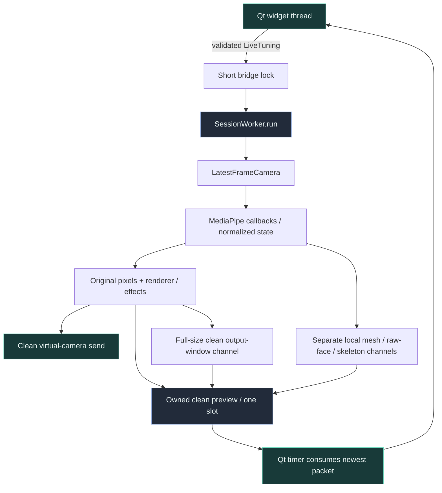
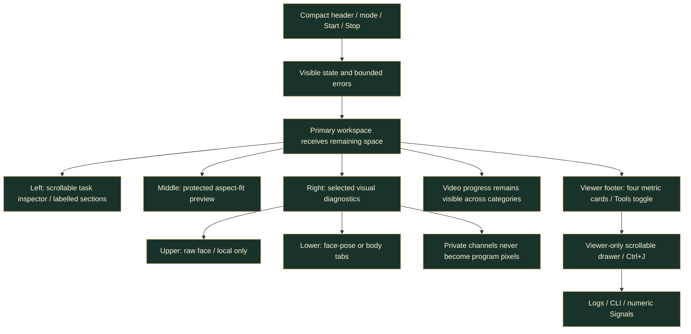
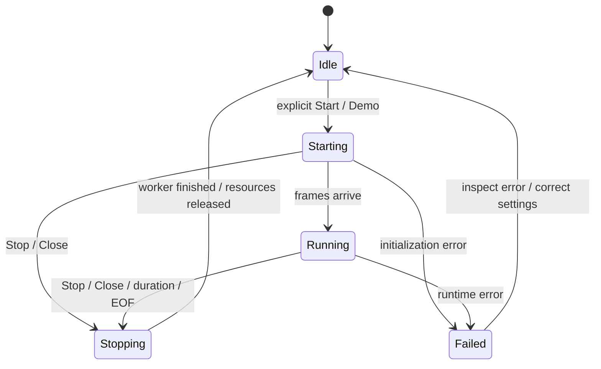

# Desktop runtime architecture

> **TL;DR:** Qt owns widgets; a single session worker owns the existing pipeline and its native
> resources. A toolkit-neutral bridge transfers immutable tuning and one latest preview, not
> a growing stream of queued frame signals.

## One pipeline, two hosts

`cli.main(argv, runtime=None)` remains the CLI host. With no bridge, it retains terminal reporting,
SIGINT handling and OpenCV preview windows. `gui.worker.SessionWorker.run` calls the same function
with a `RuntimeBridge`: no worker-thread signal-handler installation and no HighGUI windows.
The GUI's `--headless` option suppresses local image transfer, not clean virtual output.

The shared `cli.validate_options` validates source, mode combinations, dimensions and tuning
before native allocation. `gui.settings.namespace/arguments` reuse this contract rather than
maintain separate numeric/mode rules. A coverage test compares parser destinations with every
declarative GUI field, so adding a CLI feature without a native control fails visibly.
GUI validation disables source-file inspection: model existence and recorded-source detection
happen on the worker, not during slider callbacks. Editing controls does not repeatedly touch
disk or query an unavailable network path.

## Data contracts and ownership

`LiveTuning` contains an immutable `EyeSensitivity`, brightness and debounce intervals.
The main thread validates the complete tuple before replacing it under a lock. The worker
reads a snapshot between frames, applies eye rules to the action detector and renderer, and
uses the chosen brightness for the next processing copy. Invalid edits remain visible but
do not replace the last valid tuple.

`RuntimeTelemetry` separates raw/filtered face state, actual rendered eye state, effective detection, measured
capture/tracker rates, internal frame age, output device and explicit synthetic/raw flags.
The GUI must not infer safe masking solely from `face.detected`: an unmasked mode is deliberately
available, and body/marker resolvers can have different state from the face tracker.

`RuntimeBridge.publish` bounds display copies to 1280x800 while preserving aspect ratio. The
clean compositor/output stays full-size. A separate full-resolution owned frame feeds the
controls-free output window, while mesh/raw-face/skeleton buffers feed the local diagnostic rail.
The mailbox owns its copies; `VideoCanvas.set_frame`
also detaches the QImage from NumPy. Replacing a worker buffer therefore cannot change pixels
while Qt is painting. No QPixmap or QWidget is touched by the worker.

There are at most one waiting preview packet and one packet currently being consumed. This
bound excludes the camera's own latest slot, trackers, renderer targets and virtual output,
which retain their existing ownership. Memory is bounded structurally, not claimed constant
across different source resolutions.

## Preview-first containment

The window keeps a left inspector and right program workspace in a non-collapsible horizontal
splitter. Each settings category is scrollable; `settings.SECTIONS` groups the same `PAGES`
fields without changing their values or parser destinations. Expanding a section does not
recreate its controls or restart a worker. Tooltips and accessible descriptions carry secondary
field help; raw-consent warnings remain explicit.

Raw face and face/pose or body use a protected vertical splitter in a right-hand rail beside
the main canvas. A horizontal splitter lets the user adjust preview/rail widths without
collapsing either. `debug_face_preview`, `tracking_debug` and `full_body` control the relevant
panels; disabled channels reclaim their space. Headless/Video states hide this Live-only rail.

Logs/CLI/numeric Signals are inside a closed-by-default `QScrollArea` drawer with a height cap.
The drawer belongs to the viewer column, not the entire window, so opening it does not shorten
the inspector. Four persistent footer cards reuse the existing metric QLabel bindings and
remain visible beside the Tools toggle. The drawer can shrink and scroll when space is tight.
A fixed-height dock was not sufficient: the old
220px canvas could be clipped to 76px by its parent at 1120x780. Raising only the child's
minimum repeats that defect. Error messages are a bounded, scrollable plain-text surface;
video progress stays in the program workspace rather than the inspector page. Tools has an
explicit 1px minimum so Qt can shrink its otherwise 70px scroll-area minimum hint. Error
details can shrink within 48-68px while retaining complete scrollable text.

Runtime polling updates owned raw/mesh/body buffers independently of Tools visibility. Compact
eye decisions remain near eye tuning; full eye/pose signals are in Tools > Signals, while
camera/tracker rates, internal frame age and output state remain in the footer cards. The shared preset
actions and model buttons visibly reflect busy state. Logging continues regardless of drawer
visibility, and the explicit headless option leaves an explanatory workspace.

Native regressions check the whole widget and fitted image against its actual visible region,
not only its `isVisible` flag. They cover small windows, long errors, diagnostics, mode/page
changes, splitter dragging, both image orientations and controlled Qt scaling. These checks
establish containment on the tested platform, not universal hardware or live-camera accuracy.
Diagnostic regressions also inspect actual aspect-fitted image area, rather than treating a
visible but unusably small thumbnail as a successful design.
The selected rail's real minimum height propagates explicitly into its horizontal splitter;
footer content cannot override the diagnostic image minima. Card regressions inspect borders,
native-font text fit and unchanged inspector height with Tools open, not only object names.

The persistent **Show clean output** button and View entry share one QAction. Closing the
controls-free window hides it without stopping the worker; runtime polling continues updating
its owned clean-frame buffer. Reopening shows the same window and latest clean pixels, without
changing **Auto-open**. Manual idle opening stays black and starts no source. Raw/headless/Video
configurations disable the action and hide/clear the window rather than displaying private data.

## Live eye calibration

`tracking.eyes.EyeSensitivity` is the shared source of blink/wink rules.

For anatomical eye `e`, a direct closure is `openness[e] <= blink_threshold[e]`. Relative wink
closure also requires openness at or below the common wink threshold, the opposite eye at or
above the common open threshold, and the required left/right asymmetry.

Both effective per-eye blink thresholds must be lower than the open and wink thresholds.
Finite values lie in [0,1]. Existing `--blink-threshold` remains the shared fallback; optional
`--left-blink-threshold` and `--right-blink-threshold` override only their respective eyes.
An unused shared fallback does not override two explicit valid per-eye values.

`FaceActionDetector.set_thresholds` clears eye transition/blink timing when eye calibration
changes, avoiding an artificial blink spanning two configurations. It does not reset an
unchanged mouth channel. Both renderers accept the same sensitivity without rebuilding GPU
resources or discarding the last-safe image. Texture regeneration remains conditional on the
resulting open/closed expression changing.

Action logs and visual closure decisions use raw eye controls, while geometry/pose and mouth
remain filtered. `render_eye_state` prevents the One Euro filter from smoothing away brief blinks.
Both renderers still use the same `EyeSensitivity`. Telemetry carries the actual render state so
fallback/held expressions are not misrepresented as raw face decisions.

`calibrate_eyes` uses at least 12 distinct observations for each OPEN/CLOSED phase. Conservative
open/closed quantiles must have a useful gap. It derives both per-eye blink thresholds and the
shared open/wink/asymmetry rules together. Overlapping ranges fail explicitly, retaining existing
settings. `EyeCalibrationDialog` uses a countdown and timed sampling without saving face images.

## Lifecycle and failure handling

The worker creates, uses and closes the standalone ModernGL context on the same thread.
`ExitStack` registers resource cleanup immediately after each successful acquisition. If later
initialization fails, already-created trackers are closed. Output closes before rendering and
tracking resources; camera shutdown is also attempted. The outer Qt-thread exception boundary
reports unexpected failures to the console, not a success-shaped empty preview.

Stop sets a thread event. Camera reads use short condition-wait timeouts in GUI mode so the
loop can observe it without a per-frame queued Qt slot. A native camera open/read/release can
still block internally. A cancellation received during model initialization is checked before
acquiring output and again before starting capture, so cancelled startup does not open a new source.
Closing during work keeps the window alive, requests Stop, and completes
after `QThread.finished`; it does not call `terminate`, block the UI with `wait`, or destroy a
running QThread. This is cooperative shutdown, not process/crash isolation.

## Logs and subprocess tasks

### Native machine camera selection

The Camera page explicitly separates **This computer's camera** from custom stream/file/index
input. Named Windows discovery uses the optional
[`cv2-enumerate-cameras`](https://github.com/lukehugh/cv2_enumerate_cameras) metadata adapter in an
owned subprocess, reusing the existing job lifecycle. Its Windows implementations query
`MFEnumDeviceSources` or DirectShow's device enumerator/property bags; they do not call
`VideoCapture`, read frames, or activate a media source. No vendor camera client/driver is installed.

`camera.devices.discover_local_cameras` enumerates each supported API explicitly. It does not
mix OpenCV's backend-encoded `CAP_ANY` indices with a different explicit backend. A named row
contains a validated name, API and index; selecting it updates source/backend together.
Device paths/serials are not returned or persisted. Listings are snapshots, so refresh/reselect
after hardware changes; a missing previous selection is cleared rather than silently retargeted.
Device `0` is a manual fallback, not an assertion that it is always the laptop camera.

The native selector starts no capture merely from switching mode, refreshing, or selecting a row.
Custom URL/file input and its backend are retained only in session memory when switching back.
Named discovery is currently Windows-specific; manual index capture remains available elsewhere.

Worker logs have a 500-entry ring; an overflow notice explicitly counts dropped older entries.
The visible plain-text console retains at most 1,500 text blocks. Camera URLs, including query
strings and authentication, are redacted before entering the GUI buffer/clipboard.
Native library messages may still use the launching terminal's stderr; this is not a promise
of universal third-party log interception.

Checksum-verifying model helpers and the existing recorder run as owned QProcesses. Arguments
are constructed from typed controls without a shell. Only one session or job runs at a time.
Model verification checks existing files; explicit force download can replace them after checksum
verification. Model downloads are network operations only when the user requests them.

The recorder's hidden `--stop-file` is a cooperative cancellation contract: the header Stop
creates a marker in an owned temporary directory; the recorder checks it in countdown/capture
loops and still flushes its writer/CSV in `finally`. Its raw preview remains a separate recorder
window. This UI addition deliberately does not alter the existing recording timing policy.

## Persistence and distribution boundary

Presets contain a versioned allowlist of current CLI control values. Source and raw-face preview
consent are excluded. Loading never starts capture and resets raw consent. Imported data cannot
supply arbitrary command names or executable code. Model fields accept local paths, not stream URLs.

The GUI extra is optional. `python -m kardboard_vtuber` does not import Qt.
`python -m kardboard_vtuber.gui` and the `kardboard-studio` GUI entry point launch the native app.
The supplied canonical PNG and derived application icons are packaged under `gui\assets`.
`scripts\build_branding.py` derives a transparent 256-pixel PNG and a Windows ICO containing
16/24/32/48/64/128/256-pixel images, using the existing OpenCV/NumPy dependencies. It trims only
near-invisible outer pixels below alpha 16 from its optical bounds, preserves aspect ratio,
uses no extra margin at 16/24/32px, and resamples premultiplied color
to avoid colored fringes from invisible pixels. The master PNG is never rewritten.
The same multi-resolution icon supplies the application, window/taskbar and header branding;
the README embeds the unchanged master. This avoids separate, drifting logo designs.

Rebuild after an explicitly approved logo change with `python scripts\build_branding.py`.
This is a branding-asset transformation, not a new tracked avatar. Source helpers come from
`scripts`; installed helpers are packaged in `_tools`, with writable models/presets/recordings
kept in per-user data. See [Windows installation](windows-installation.md) for the online MSI.
v1.0.0 is the first official version; v1.1.0 added workspaces and v1.2.0 adds the preview-first UI.
Earlier v0.2.0 exports were local staging.

## Offline processing host

VIDEO uses `VideoExportWorker` around the Qt-free `video_pipeline.render_avatar_video`, also
used by `video_cli`. Unlike live capture, it never creates `LatestFrameCamera`. MediaPipe VIDEO
mode performs synchronous face/hand/segmentation inference for each decoded frame. Progress
signals are bounded in time; preview frames still use the latest-slot bridge.

`video.export_video` owns PyAV decode/encode/remux resources and preserves source PTS. FFV1/MKV
keeps processed RGB pixels lossless; H.264/MP4 CRF 17 is explicitly lossy. Audio packets are copied
through stream templates, not decoded/re-encoded. A same-filesystem temporary output is published
with an atomic no-overwrite hard link only after successful close; cancellation/errors remove
the owned temporary directory without touching input or existing outputs.

See [video processing and its supported-input boundary](video-processing.md).
