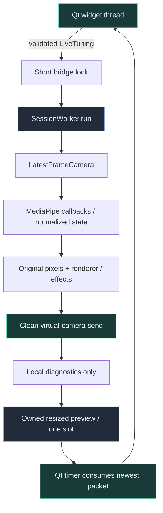
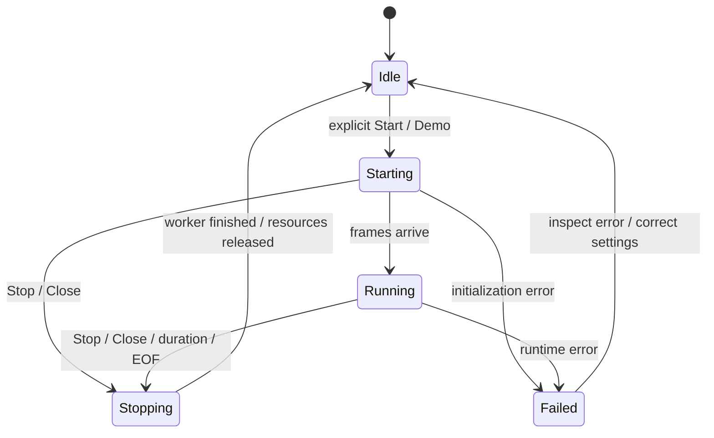

# Desktop runtime architecture

> **TL;DR:** Qt owns widgets; a single session worker owns the existing pipeline and its native
> resources. A toolkit-neutral bridge transfers immutable tuning and one latest preview, not
> a growing stream of queued frame signals.

## One pipeline, two hosts

`cli.main(argv, runtime=None)` remains the CLI host. With no bridge, it retains terminal reporting,
SIGINT handling and OpenCV preview windows. `gui.worker.SessionWorker.run` calls the same function
with a `RuntimeBridge`: no worker-thread signal-handler installation and no HighGUI windows.
The GUI's `--headless` option suppresses local image transfer, not clean virtual output.

The shared `cli.validate_options` validates source, mode combinations, dimensions and tuning
before native allocation. `gui.settings.namespace/arguments` reuse this contract rather than
maintain separate numeric/mode rules. A coverage test compares parser destinations with every
declarative GUI field, so adding a CLI feature without a native control fails visibly.
GUI validation disables source-file inspection: model existence and recorded-source detection
happen on the worker, not during slider callbacks. Editing controls does not repeatedly touch
disk or query an unavailable network path.

## Data contracts and ownership

`LiveTuning` contains an immutable `EyeSensitivity`, brightness and debounce intervals.
The main thread validates the complete tuple before replacing it under a lock. The worker
reads a snapshot between frames, applies eye rules to the action detector and renderer, and
uses the chosen brightness for the next processing copy. Invalid edits remain visible but
do not replace the last valid tuple.

`RuntimeTelemetry` separates raw/filtered face state, effective rendered detection, measured
capture/tracker rates, internal frame age, output device and explicit synthetic/raw flags.
The GUI must not infer safe masking solely from `face.detected`: an unmasked mode is deliberately
available, and body/marker resolvers can have different state from the face tracker.

`RuntimeBridge.publish` bounds display copies to 1280x800 while preserving aspect ratio. The
clean compositor/output stays full-size. The mailbox owns its copies; `VideoCanvas.set_frame`
also detaches the QImage from NumPy. Replacing a worker buffer therefore cannot change pixels
while Qt is painting. No QPixmap or QWidget is touched by the worker.

There are at most one waiting preview packet and one packet currently being consumed. This
bound excludes the camera's own latest slot, trackers, renderer targets and virtual output,
which retain their existing ownership. Memory is bounded structurally, not claimed constant
across different source resolutions.

## Live eye calibration

`tracking.eyes.EyeSensitivity` is the shared source of blink/wink rules.

For anatomical eye `e`, a direct closure is `openness[e] <= blink_threshold[e]`. Relative wink
closure also requires openness at or below the common wink threshold, the opposite eye at or
above the common open threshold, and the required left/right asymmetry.

Both effective per-eye blink thresholds must be lower than the open and wink thresholds.
Finite values lie in [0,1]. Existing `--blink-threshold` remains the shared fallback; optional
`--left-blink-threshold` and `--right-blink-threshold` override only their respective eyes.
An unused shared fallback does not override two explicit valid per-eye values.

`FaceActionDetector.set_thresholds` clears eye transition/blink timing when eye calibration
changes, avoiding an artificial blink spanning two configurations. It does not reset an
unchanged mouth channel. Both renderers accept the same sensitivity without rebuilding GPU
resources or discarding the last-safe image. Texture regeneration remains conditional on the
resulting open/closed expression changing.

Action logs use raw controls while visual rendering uses filtered controls, preserving the
existing distinction. A filter may delay a visible transition relative to a raw action event;
the studio displays both values rather than pretending they are identical.

## Lifecycle and failure handling

The worker creates, uses and closes the standalone ModernGL context on the same thread.
`ExitStack` registers resource cleanup immediately after each successful acquisition. If later
initialization fails, already-created trackers are closed. Output closes before rendering and
tracking resources; camera shutdown is also attempted. The outer Qt-thread exception boundary
reports unexpected failures to the console, not a success-shaped empty preview.

Stop sets a thread event. Camera reads use short condition-wait timeouts in GUI mode so the
loop can observe it without a per-frame queued Qt slot. A native camera open/read/release can
still block internally. A cancellation received during model initialization is checked before
acquiring output and again before starting capture, so cancelled startup does not open a new source.
Closing during work keeps the window alive, requests Stop, and completes
after `QThread.finished`; it does not call `terminate`, block the UI with `wait`, or destroy a
running QThread. This is cooperative shutdown, not process/crash isolation.

## Logs and subprocess tasks

Worker logs have a 500-entry ring; an overflow notice explicitly counts dropped older entries.
The visible plain-text console retains at most 1,500 text blocks. Camera URLs, including query
strings and authentication, are redacted before entering the GUI buffer/clipboard.
Native library messages may still use the launching terminal's stderr; this is not a promise
of universal third-party log interception.

Checksum-verifying model helpers and the existing recorder run as owned QProcesses. Arguments
are constructed from typed controls without a shell. Only one session or job runs at a time.
Model verification checks existing files; explicit force download can replace them after checksum
verification. Model downloads are network operations only when the user requests them.

The recorder's hidden `--stop-file` is a cooperative cancellation contract: the header Stop
creates a marker in an owned temporary directory; the recorder checks it in countdown/capture
loops and still flushes its writer/CSV in `finally`. Its raw preview remains a separate recorder
window. This UI addition deliberately does not alter the existing recording timing policy.

## Persistence and distribution boundary

Presets contain a versioned allowlist of current CLI control values. Source and raw-face preview
consent are excluded. Loading never starts capture and resets raw consent. Imported data cannot
supply arbitrary command names or executable code. Model fields accept local paths, not stream URLs.

The GUI extra is optional. `python -m kardboard_vtuber` does not import Qt.
`python -m kardboard_vtuber.gui` and the `kardboard-studio` GUI entry point launch the native app.
The original SVG KC-box icon is packaged with the Python module. Model/recording helper actions
currently require the source checkout's `scripts` directory; an installer is a separate deliverable.
