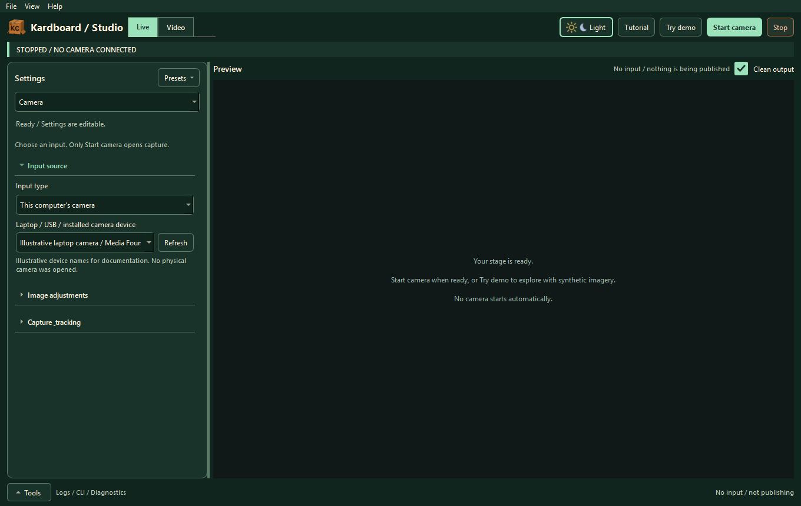
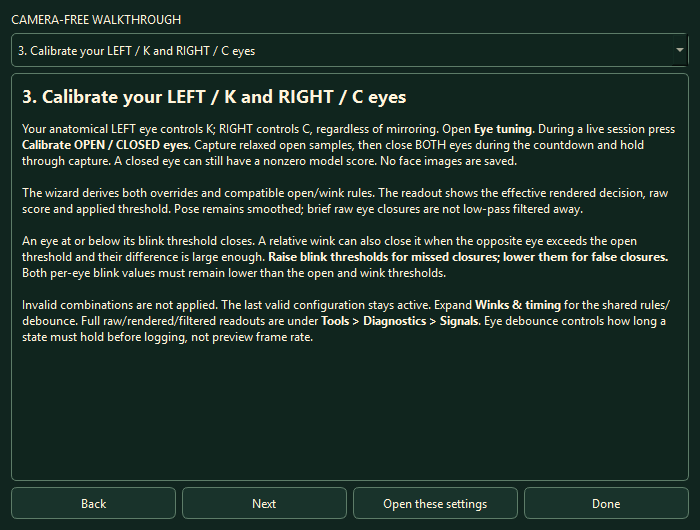
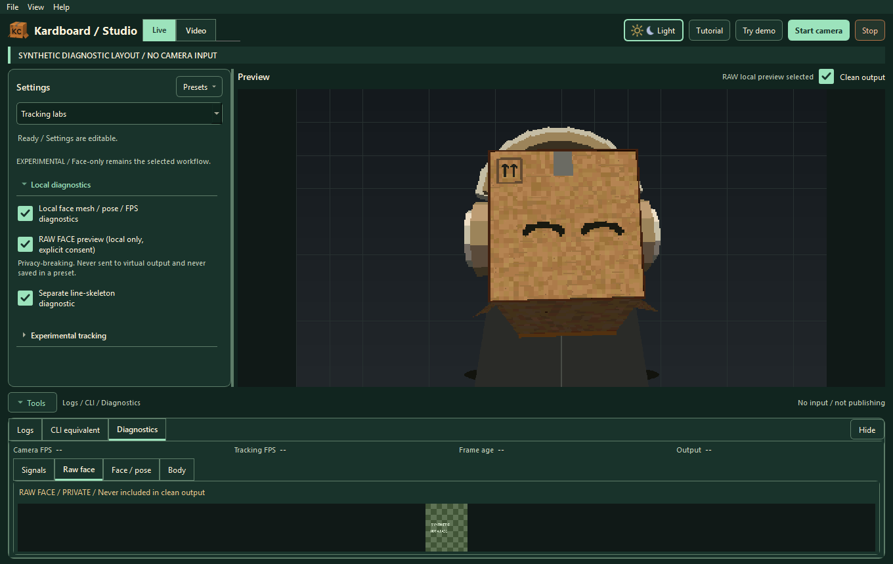
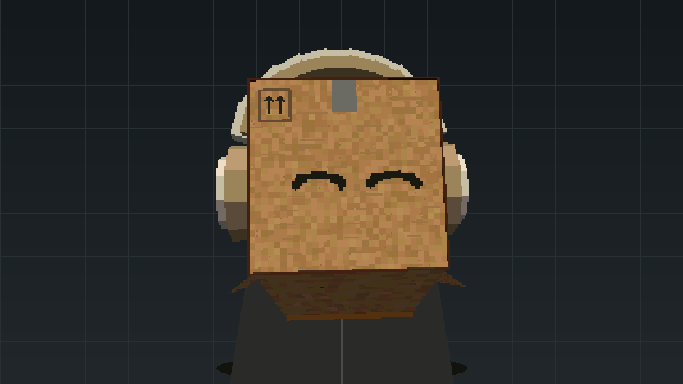
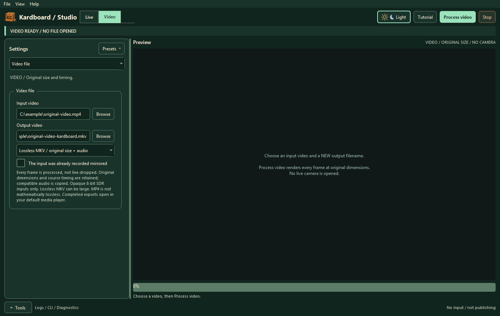

# Studio tutorial

> **TL;DR:** Choose **LIVE** for cameras/streaming or **VIDEO** to process an existing recording.
> Calibrate actual OPEN/CLOSED eye scores. Diagnostics stay in optional Tools, while the
> separate clean window supports OBS Window Capture. Nothing captures or records automatically.

## 1. Install and launch

From the project root:

```powershell
.\.venv312\Scripts\python.exe -m pip install -e ".[dev,tracking,virtual-camera,gui]"
.\.venv312\Scripts\python.exe -m kardboard_vtuber.gui
```

Or use `.\.venv312\Scripts\kardboard-studio.exe` after editable installation.
The GUI extra includes the video codec library; the ordinary camera CLI remains Qt-free.
Use **Tutorial** in the header for the in-app walkthrough. It works before camera access.

## 2. Explore without a camera

Click **Try demo**, or launch:

```powershell
.\.venv312\Scripts\python.exe -m kardboard_vtuber.gui --demo
```

This uses the real renderer and simulated signals on a labelled synthetic stage. It never opens
a camera, runs live inference, records or publishes OBS Virtual Camera output. It can show the
clean output window for layout review. Demo FPS values are unavailable, not invented measurements.

The compact header switches between **Live** and **Video**. The left inspector contains Camera,
Video file, Avatar & eyes, Output & effects, Tracking labs, Private capture, Models and Tutorial.
Expand labelled sections for secondary controls and scroll within a category. The large preview
stays on the right. **Tools** / **Ctrl+J** opens Logs, CLI equivalent and Diagnostics; it starts
closed and does not cover the viewer.

## 3. Verify models and enter a source

Stop other work. **Models → Verify / download** checks the expected hash or explicitly downloads
the required official model. Force replacement is deliberate; "present" alone is not verification.

For laptop/USB input choose **Camera → This computer's camera → Refresh → named device**.
Listing metadata does not open a stream. Each named choice keeps its matching API/index.
Windows startup may populate that metadata list, but capture starts only with **Start camera**.

Index `0` is the first device for an API, not an extra camera or a guaranteed laptop identity.
Media Foundation and DirectShow are alternative Windows capture backends, often exposing the
same integrated camera, not RGB/IR modes. Equal names alone do not prove physical identity.
Refresh/reselect after hardware changes; a missing previous named device is cleared.



*Actual source controls with illustrative device names; no camera capture.*

Choose **Phone stream / video file / manual source** for a phone URL, live-paced file replay or
manual index. Sources/backend choices stay in session memory, not presets. Virtual devices can
appear; never select OBS Virtual Camera as input while sending to that same output.

```powershell
$env:KARDBOARD_CAMERA_URL = Read-Host "Paste your current camera stream URL"
.\.venv312\Scripts\python.exe -m kardboard_vtuber.gui
```

Set the variable in the same terminal before launch. Do not recover old credentials from history.
Expand **Image adjustments** for rotation/mirroring; already mirrored recordings have a separate flag.
**Capture & tracking** contains backend, requested dimensions/FPS and other capture details.
Tracking width changes analysis cost/detail, not final camera resolution.

## 4. Start and calibrate

Press **Start camera**. Initialization runs off the widget thread. Face-only cardboard begins
black before acquisition and freezes the last-safe composite on face loss. This is a failure
policy, not proof of perfect coverage for every detected angle.

In **Avatar & eyes → Eye tuning**, use **Calibrate OPEN / CLOSED eyes** during a real live session:

1. Face the camera with both eyes relaxed and open; capture the open samples.
2. Begin the closed phase, close **both eyes** during its countdown and hold through capture.
3. The wizard derives compatible left/right/open/wink thresholds together. Overlapping ranges
   fail visibly; repeat rather than assuming a physically closed eye must have model score zero.

Only numeric observations are used; no face images are saved. K follows anatomical left and C
anatomical right. Compact OPEN/CLOSED decisions stay next to tuning. **Tools → Diagnostics →
Signals** shows raw/rendered scores, applied thresholds and pose. Geometry/pose remain smoothed;
brief raw eye closures are not filtered away.

For manual tuning, **raise** blink thresholds for missed closures and **lower** them for false
closures. Each must stay below both open/wink rules. An invalid edit displays **Not applied** and
retains the last valid tuple. Shared blink is only the fallback for an eye whose Override is off.
Relative wink rules also require the opposite eye to be open and sufficient asymmetry.
Expand **Winks & timing** for those shared rules and debounce controls.



*The in-app instructions explain timed sampling and effective closure decisions.*

**LIVE** fields update during a live session. Other fields dim and show **LOCKED**, with a
persistent Stop-to-unlock explanation. Video-mode Live-only controls are labelled. Offline
processing locks every processing option until completion/cancellation. Internal brightness
affects analysis only; width/brightness are not proven distance-tracking fixes.

## 5. Avatar, effects and separate diagnostics

Expand **Avatar setup**. Textured 3D is canonical; disable physics before selecting procedural 2D for comparison.
Depth offset changes perspective placement and supports direct numeric entry without an
artificial positive cap. Preview resizing does not crop or change source processing resolution.

The program image stays unobstructed. Open **Tools → Diagnostics** and choose **Raw face**,
**Face / pose** or **Body**. Only the requested diagnostic is displayed in that secondary area;
enabling diagnostics does not create columns that squeeze the viewer. They do not enter clean output.
Skeleton diagnostics do not fill a full-body avatar into camera video.



*Actual layout with synthetic placeholders, not a saved face image.*

Green screen preserves the person over chroma green. Hand foreground restores conservative
anatomical regions; RGB does not establish physical depth or recover arbitrary held objects.
Inferred-depth foreground restoration was removed after privacy failures.

## 6. Use as a camera or a clean OBS window

### OBS Virtual Camera

Install OBS Studio's Windows camera component once. Enable **Send clean video to OBS Virtual
Camera** in Output & effects. Choose SD, HD, Full HD, QHD, 4K, portrait or current-display
resolution plus advertised FPS. The display option reads the screen this Studio window is on;
moving monitors does not change an already running output. Stop/restart to change topology.

Select **OBS Virtual Camera** in the calling application. OBS itself may stay closed, but only
one producer can own it. No custom KardboardCode-named camera driver is installed.
Video is aspect-fitted with black bars; select microphone audio separately. Advertised FPS is
not guaranteed delivered motion speed. Actual calling-app permissions still need qualification.

### Separate clean window for OBS Window Capture

**Clean output** beside the preview is enabled by default for Live/demo.
The stable **KardboardCode - Clean Output** window contains only clean program video.
Select its client area in OBS Window Capture; it is distinct from OBS Virtual Camera.
Closing it hides the window, not the live pipeline. Reopen it from View. Raw/unmasked modes
do not populate this clean-output channel.



*Actual controls-free synthetic output. No diagnostic overlays or private face panel.*

**Camera → Capture & tracking → Suppress preview** intentionally suppresses local video transfer
while retaining processing/virtual delivery. Its workspace remains visible with an explanation.
Clean output is full-resolution before display scaling; Studio diagnostic copies are bounded.

## 7. Advanced tracking and raw debug

Tracking labs labels shoulder and hood modes experimental. Face-only remains the selected
default. Shoulder fallback needs calibration. Hood mode uses green anatomical-left and blue
anatomical-right squares; red/pink are unsupported. The fallback modes cannot be combined.
Missing face/side markers does not confirm rear orientation.

Raw face preview and unmasked-camera operation require acknowledgement on each real start.
Screen capture can still expose that private Studio panel. Presets never retain raw consent.
Showing an available pose is not evidence that the estimate is visually accurate or private.

## 8. Process a prerecorded video

Choose front **Video** mode; the **Video file** inspector opens. Browse an input and a NEW output filename. Default **lossless
FFV1/MKV** avoids additional compression loss but can be large. **High-quality H.264/MP4 CRF 17**
is smaller and explicitly lossy. The original/existing outputs are never overwritten.

Configure avatar/eyes, models and optional green-screen/hand effects, then **Process video**.
Export progress stays beside the preview when you change inspector categories.
Every frame is tracked/rendered synchronously at source dimensions and timestamp spacing
within container precision. Compatible audio packets are copied. Source mirror/rotation,
live capture/virtual-output dimensions and experimental body/marker modes do not apply.
Mark already-mirrored input for correct anatomical semantics without flipping pixels again.

Supported input is opaque, progressive, square-pixel 8-bit SDR with valid timing. Unsupported
HDR/alpha/rotation/interlacing or container/codecs fail explicitly, never through hidden quality
conversion. Stop cancels and cleans owned temporary output. See [video processing](video-processing.md).

When processing succeeds, Studio automatically opens the completed file in your default media
player. Failed or cancelled jobs do not open anything. If no application can be launched, the
video remains saved and Studio displays its path and an actionable error. Your selected player
must support the output format; lossless FFV1/MKV support varies between players.



*Actual export controls with illustrative paths. No camera opens.*

## 9. Advanced private capture and replay

This is a **LIVE-mode utility**, not VIDEO processing. Stop other work, open **Private capture**
and choose guided face/full-body or free recording. Free duration applies only to free mode;
guided stages have their own timing. Set countdown, pose width/rate, raw-preview height,
destination folder and filename stem.

The existing recorder reuses source/transforms/model selections and saves **unmasked private
MP4 + CSV**, not safe avatar output. Its own raw preview is separate. Stop requests a cooperative
finish; native camera blocking may delay it. The fixed-FPS writer can compress playback duration
when actual delivery is slower. That old capture limitation remains unresolved.

Keep raw footage private. Browse it as a live-paced replay for diagnostics, or process it in VIDEO.

## 10. Presets, command copying, logs and stopping

Use **Presets** in the inspector or the File menu. Presets remember validated controls, not
sources or raw consent. Loading starts nothing. Open **Tools** / **Ctrl+J**; its
**CLI equivalent** tab copies the complete runnable command for the active mode.
Live commands substitute same-terminal source setup instead of credentials; video commands
include the chosen local input/output paths. **Logs** is bounded/selectable and continues
collecting while Tools is closed. Long error messages remain readable in their scrollable banner.
Native libraries can still write separate stderr.

| Symptom | First checks |
|---|---|
| Empty/invalid source | Enter it here or set the variable before launching this process |
| Missing model | Select a valid file in Models and explicitly verify/download |
| Frozen output | Face visibility/framing/lighting; do not disable safe loss handling |
| Missed blink | Guided OPEN/CLOSED samples; raise thresholds, inspect effective decisions |
| Virtual camera unavailable | Installed component, competing producer, app permissions |
| Video export fails | Supported source, NEW output, correct extension and compatible audio/container |
| Dimmed controls | Stop first; only LIVE controls remain editable during live work |
| Slow shutdown | Owned native work is still pending; cleanup is cooperative |

Stop remains in the header. Close during work requests shutdown, keeps the event loop alive and
closes after the worker finishes; it never forcibly terminates a Qt thread.
