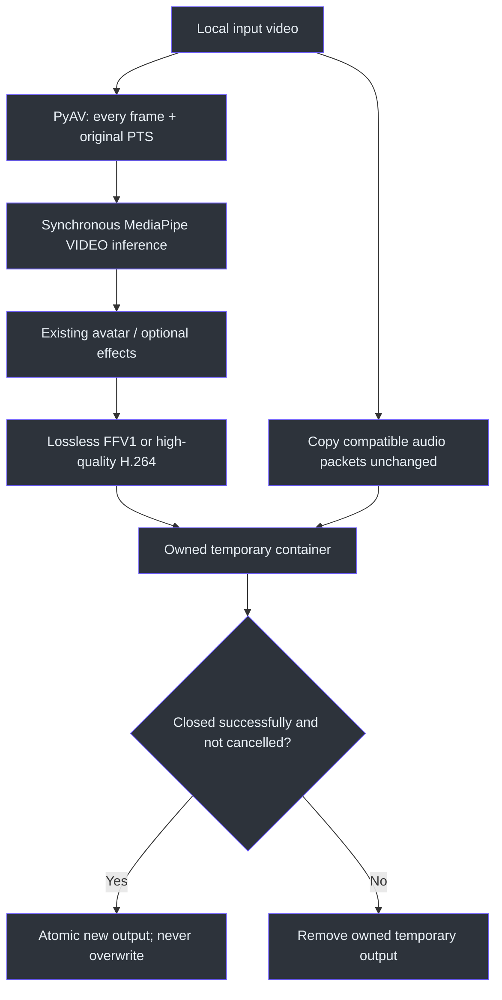
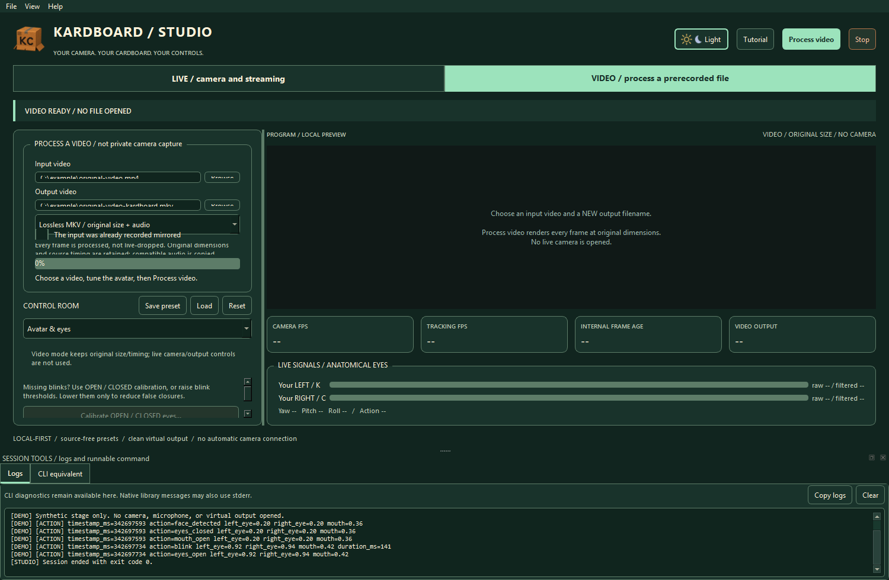
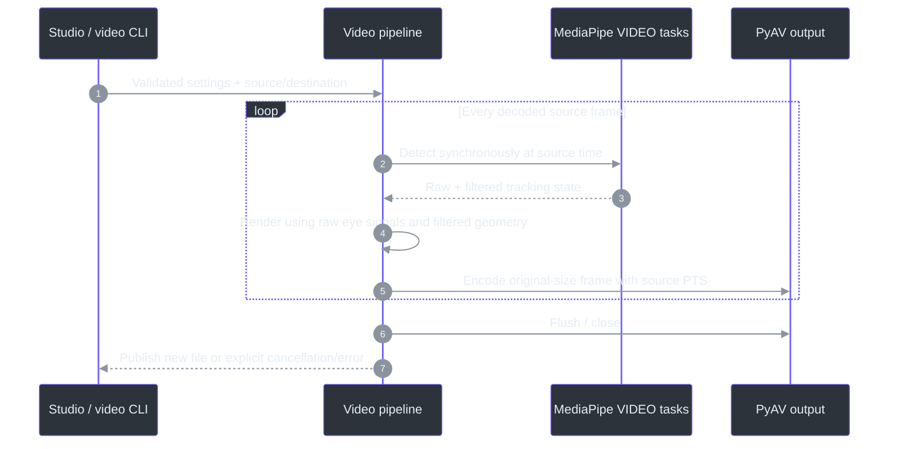

# Prerecorded video processing

> **TL;DR:** Choose **VIDEO**, select an existing input and a new output filename, tune the avatar
> and process. This is not the old private camera recorder. No live camera opens.
> After a successful Studio export, the completed file opens in your default media player.

## Why a separate mode exists

Live capture intentionally drops obsolete frames to stay current. Offline rendering must do the
opposite: decode, track and render every frame, even when processing is slower than playback.
It must not inherit camera mirroring, capture dimensions or an advertised virtual-camera FPS
(`src/kardboard_vtuber/video.py:60-195`; `src/kardboard_vtuber/video_pipeline.py:43-140`).



## Format contract

| Choice | Video | Audio | Intended use |
|---|---|---|---|
| Lossless MKV, default | FFV1, opaque 8-bit RGB output without additional compression loss | Compatible streams copied | Quality-preserving master, potentially large |
| High-quality MP4 | H.264, CRF 17, medium preset, YUV420 | Compatible streams copied | Smaller, broadly usable delivery; explicitly lossy |

The avatar changes pixels, so output cannot be byte-identical to the source file. Lossless refers
to the **processed RGB frames**, not to retaining the original compressed video bitstream.
Source dimensions are not resized. Presentation timestamps preserve source spacing to the output
container's precision; Matroska commonly quantizes timestamps to milliseconds. No live-rate frame
dropping, artificial fixed-FPS acceleration or silent audio transcoding occurs
(`video.py:70-195`).

Supported input is one opaque, progressive, square-pixel, 8-bit SDR video stream with valid
timestamps and usable rate metadata. HDR/high-bit-depth, alpha, interlacing, rotation metadata,
changing dimensions and invalid timestamps fail explicitly. MP4 additionally needs even source
dimensions and compatible audio codecs. Additional subtitle/data/attachment streams fail explicitly instead
of being silently discarded. Use MKV when an audio codec is not supported by MP4.
Unsupported inputs are not silently downconverted.

## Studio operation

1. Stop other work and choose the front **VIDEO** mode.
2. Browse an input and a **new** output filename.
3. Choose MKV or MP4; keep the extension matching the selected format.
4. If the file was already mirrored, mark that fact so anatomical eye semantics are correct.
   The raster itself is not mirrored again.
5. Configure avatar/eyes, models and optional green-screen/hand effects.
6. Press **Process video**. All processing settings lock; progress reports frame count, source
   seconds and original dimensions. Stop cancels cooperatively.
7. Once export and worker cleanup finish successfully, Studio opens the actual saved output
   using the system's default application for its file type. Failed/cancelled jobs open nothing.
   If the OS cannot launch a player, Studio keeps **VIDEO SAVED** and shows an explicit error
   with the saved path; the export is not discarded or retried.

The selected player must support the exported codec/container, especially lossless FFV1/MKV.
Accepting a launch request does not guarantee codec support. No particular player is installed
or hardcoded. Command-line video exports remain noninteractive and Qt-free.



*Actual widgets with illustrative paths. Capturing this documentation image did not open a video or camera.*

Live transforms, virtual-camera output and experimental body/hood modes are not used in this
mode. Those controls are labelled Live-only. The existing RAW recorder remains an advanced
**Private capture** utility under LIVE; it is not the export workflow
(`src/kardboard_vtuber/gui/window.py`, `_change_work_mode`, `start_video`, `_set_busy`).

## Command-line equivalent

The bottom CLI tab copies a runnable command for the active mode. For example:

```powershell
.\.venv312\Scripts\python.exe -m kardboard_vtuber.video_cli `
  --input-video='C:\videos\input.mp4' `
  --output-video='C:\videos\input-kardboard.mkv' `
  --video-quality lossless `
  --physics
```

Replace the illustrative file paths with your own local files. The input/output path is never a
camera endpoint. Ctrl+C requests cancellation. Qt is not imported by the video CLI
(`src/kardboard_vtuber/video_cli.py:1-90`).



## Ownership and validation

The worker owns tracker/GPU creation, use and close on one thread. ExitStack releases partial
initialization too. Preview transfer is throttled and bounded independently from encoding: a
slow GUI cannot cause frames to disappear from the output.

Tests use genuinely encoded synthetic VFR video/audio, compare decoded lossless pixels and
timestamps, compare audio packet payloads and verify cancellation/no-overwrite behavior.
A private 30-frame recorded-footage run also exercised actual synchronous MediaPipe and GPU
rendering at 1080x1920, with face detection present. That is integration evidence, not exhaustive
visual/privacy or every-codec certification (`tests/test_video_export.py`;
`tests/test_studio_gui.py`).

## References

- `video.py` — format checks, frame loop, remux, temporary ownership and publication.
- `video_pipeline.py` — shared tracking/render pipeline and effect ownership.
- `gui/video_worker.py` — Qt thread boundary, progress and explicit error reporting.
- `gui/window.py`, `_worker_finished` — main-thread default-player dispatch for the successful
  worker result, independently of editable output fields.
- `video_cli.py` — runnable command-line host without Qt.
- `tracking/mediapipe_tracker.py` — synchronous VIDEO versus asynchronous LIVE_STREAM.
- `tracking/green_screen.py`, `tracking/hand_occlusion.py` — synchronous optional effects.
