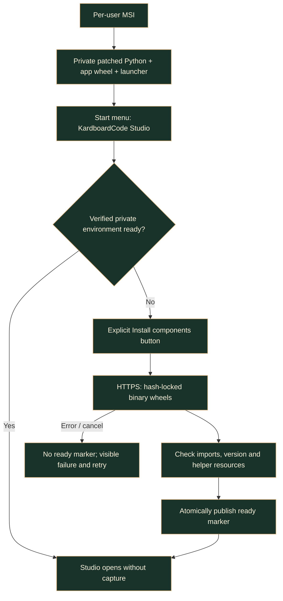
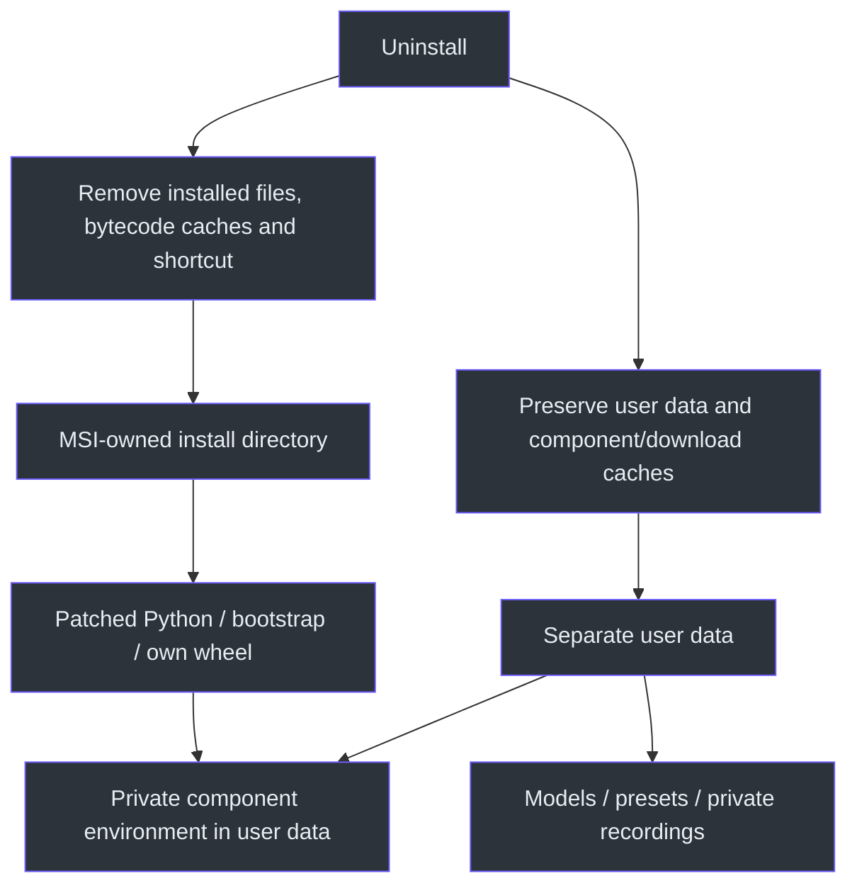

# Windows installation

> **TL;DR:** Install the per-user Windows x64 MSI, open Studio from Start, and explicitly install
> components in the first-launch window. No manual Python/pip or system PATH edits. This is an
> online, unsigned package; models and OBS's virtual-camera component remain separate.

## From setup to Studio



Download the MSI from [release](../../release/README.md), install, and open **KardboardCode
Studio** from Windows Start. Choose **Install components** and keep its progress/log window
open. Once setup succeeds, subsequent starts go directly to Studio. **Try demo** is camera-free.
Use **Models** to explicitly download the model for each feature you choose.

The intended target is Windows 10/11 x64, with a working OpenGL 3.3 graphics driver for the
textured avatar. The MSI does not install GPU or camera drivers. OBS Studio's registered
virtual-camera component is required only for that output. OBS Window Capture of the separate
clean output window is a different workflow.

**Unsigned:** compare the published SHA-256 files and obtain the package from the trusted owner.
A checksum detects changed bytes, not a publisher's identity. If organizational application
control blocks it, use the approved signing/IT process; do not turn off protections.

## Why an online MSI rather than a frozen executable?

The user explicitly selected the smaller online bootstrap instead of a large offline bundle.
The MSI contains patched CPython, the application's wheel, a stdlib/Tk setup window and the
dependency lock. Qt, MediaPipe, OpenCV, codecs and other upstream components download privately
on first launch. No existing Python installation is required or modified.

Normal private Python preserves the existing CLI, `QProcess` helpers and shared runtime instead
of adding a frozen-program dispatch protocol. Python 3.12 is deliberate: it is the established
tracking-compatible interpreter. The Windows builder also uses 3.12's `msilib`; that deprecated
module is build-only, not an application-runtime dependency.

The stdlib/Tk wizard can run before Qt exists. Work happens off its main thread; a queue feeds
bounded visible logs and progress. Cancel terminates only the owned component process. A
per-environment file lock prevents concurrent setup. Readiness is published only after successful
hash-verified installation and import/resource checks; errors are never labelled success.

## Files and ownership

| Location | Ownership |
|---|---|
| `%LOCALAPPDATA%\Programs\KardboardCode\Studio` | MSI-owned private Python, bootstrap, own wheel and icon |
| `%LOCALAPPDATA%\KardboardCode\Studio\models` | Explicitly downloaded user models |
| `%LOCALAPPDATA%\KardboardCode\Studio\presets` | Source-free saved presets |
| `%LOCALAPPDATA%\KardboardCode\Studio\recordings` | Private raw-capture default |
| `%LOCALAPPDATA%\KardboardCode\Studio\runtimes` | Version/input-specific private component environments |
| `%LOCALAPPDATA%\KardboardCode\Studio\download-cache` | Reusable package cache |

Installed code never writes models, presets or recordings into its resource directory.
`app_paths.py` detects source versus installed use once; normal source checkout paths remain
compatible. The wheel includes all four model helpers, camera metadata listing and the private
recorder. Installed copied CLI commands name the private interpreter, not a nonexistent checkout.

Windows Settings can uninstall Studio. It removes MSI-owned files and the Start shortcut, but
preserves per-user data, environments and cache. This is deliberate; reinstalling is not
permission to erase private recordings or downloaded models. Existing running source/development
instances are not automatically terminated.



## Integrity and network boundaries

`python-runtime.json` pins the patched standalone runtime URL and SHA-256.
`requirements-lock.json` records exact Windows wheel filenames/versions/hashes;
`requirements-windows.txt` feeds pip's `--require-hashes --only-binary=:all:`. Lock generation
compares each acquired wheel against authoritative PyPI release metadata. The MSI payload
manifest separately hashes its own application wheel and requirements file.

The first-launch process accepts existing verified HTTPS package-index and certificate/proxy
settings. It copies only network settings into a cleaned child environment; `PIP_TARGET`,
`PIP_USER`, prefix overrides and other unrelated pip configuration cannot redirect installation.
Plain-HTTP indexes and `trusted-host` TLS bypasses are rejected. Private feed configuration is
not shipped, and network URLs are redacted from setup logs.

If component downloads fail, inspect the visible error and retry after correcting connectivity
or the approved certificate/mirror configuration. A partially prepared environment is never
marked ready. Cancelled downloads may retain reusable cache files. Do not disable certificate
validation or change machine security policy to make setup succeed.

Qt wheels contain unusually long nested resource paths. Setup passes a canonical Windows
extended-length prefix to pip, scoped to its private environment, rather than asking users to
change the machine-wide long-path registry setting. Retry reinstalls the exact locked wheels
so a partially copied dependency cannot be mistaken for a complete installation.

## Build and release contracts

The [release handoff](../../release/README.md) contains separate source and installer manifests
and checksum files. The source ZIP never embeds generated installer/archive artifacts.

Build from the repository with Windows x64 Python 3.12:

```powershell
.\.venv312\Scripts\python.exe scripts\build_windows_installer.py
.\.venv312\Scripts\python.exe scripts\build_windows_installer.py --check
```

Only intentionally use `--update-lock` after resolving the declared runtime extras in the build
environment. It verifies upstream wheel hashes before publishing new lock data. The normal
build uses the committed lock; no private package source is written into it.

Commit public inputs, then regenerate the source export and finalize installer provenance.
`--refresh-provenance` only updates the external receipt when MSI bytes and the runtime-input
fingerprint still match; it cannot bless a stale installer. Runtime/source receipt commits are
separate from manual publication. These scripts never push, tag or create a remote release.

## Source map and evidence boundary

The real per-user MSI lifecycle was exercised with private Python 3.12.16: strict online
component setup, all six packaged helpers, installed camera/GUI/video CLI help, native
pythonw Studio, metadata-only camera discovery, checksum-only model verification, a textured
synthetic demo and clean output, saved presets, and a four-frame synchronous MediaPipe/GPU
video export. The default-player request was intercepted during testing, not sent to a real
player. No live camera was opened. Uninstall removed the complete owned installation tree
and Start shortcut while preserving both a user sentinel and saved preset.

The long-path wheel regression verifies real installation beyond 260 characters without
changing machine settings. MSI generation explicitly owns its runtime bytecode directories
so empty caches cannot strand parent folders after uninstall. Artifact-level regressions
also check that Escape on the Welcome dialog binds Cancel, not Install.

- `scripts/build_windows_installer.py`: runtime acquisition, upstream lock, wheel/image/MSI and receipts.
- `installer/windows/bootstrap.py`: manifest checks, network-only configuration, private setup and launch.
- `src/kardboard_vtuber/app_paths.py`: read-only installed resources versus writable user data.
- `src/kardboard_vtuber/gui/window.py`: installed helper jobs and visible filesystem errors.
- `tests/test_windows_setup.py`, `tests/test_app_paths.py`: integrity/cancellation/network/path regressions.
- [Workstream 12](../../TODO/12_WINDOWS_SETUP.todo): actual lifecycle evidence and remaining limits.

An installed synthetic demo establishes packaging/resource operation, not real-camera accuracy,
privacy for every pose, calling-app compatibility or owner usability approval.
