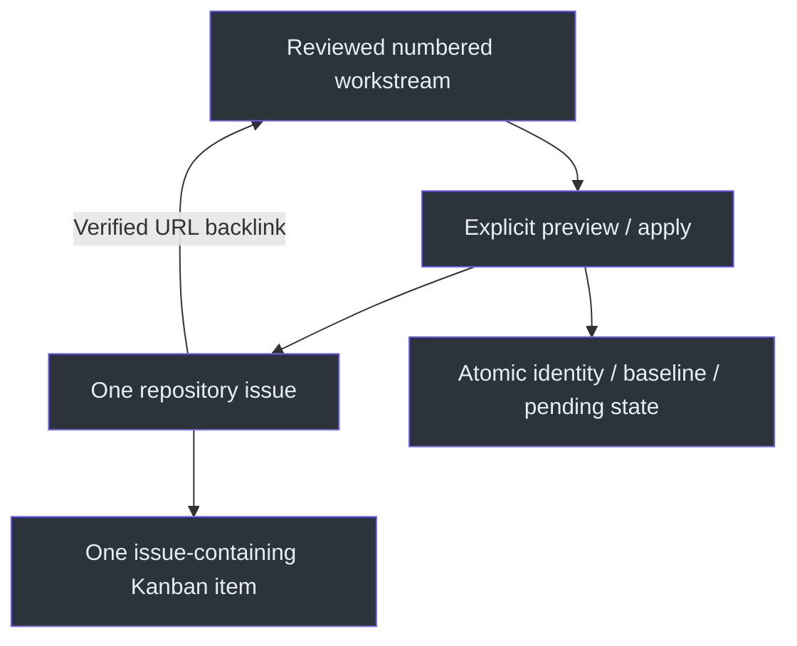
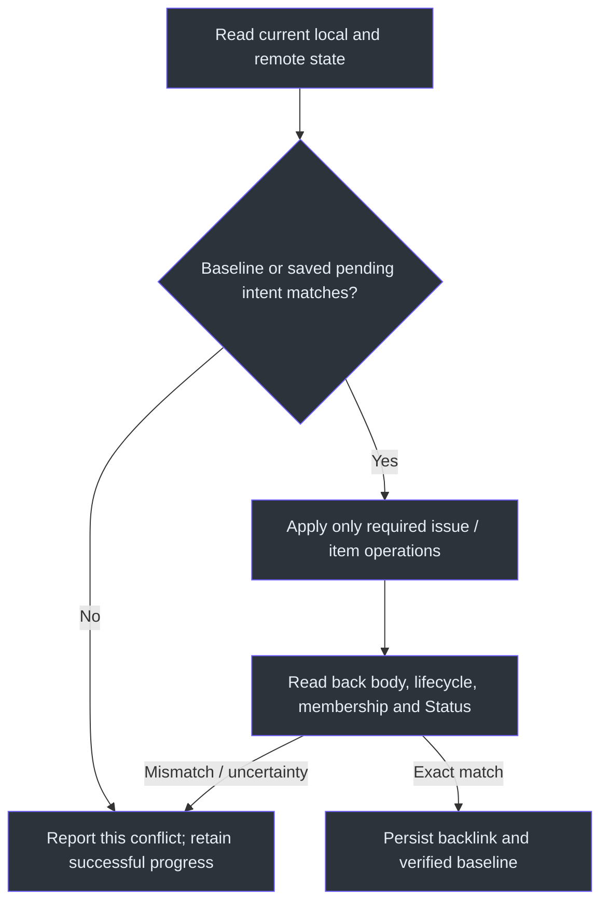

# GitHub tracking adoption

## Initial inventory and authorized scope - 2026-11-06

Canonical repository: **Zanark/KardboardCode-VTuber**, public, repository node
`R_kgDOUAny-A`, default branch `main`. The shared credential runner identified
Zanark with admin/push permission. Complete issue pagination returned zero
actual issues and six pull requests. No linked Project, local synchronizer or
previous issue mappings existed. Other named owner Projects belong to other
repositories and must remain unchanged.

The current manual is version 1.3. It supplies guidance and a credential runner,
not a synchronizer or unattended service. Reuse the reviewed standard-library
Python integration from Windowpane, adapted to this repository's Status-first
workstreams, permanent `kc-NN` identities and explicitly required Kanban view.
This is an adopted implementation choice, not a universal manual requirement.

The owner authorizes local tracking/configuration/documentation, repository-local
attribution and GitHub issue/Project creation and updates. No deferred product
implementation, commit/push, workflow activation/dispatch, scheduler, release,
deployment, permission change or remote-secret provisioning is authorized here.

## Reviewed migration inventory

| Local files | Actual meaning | Proposed remote result |
|---|---|---|
| 01-04, 06-12, 14-16, 18-23 | Twenty bounded historical workstreams, locally DONE | Twenty closed/completed issues, twenty Done issue-containing items |
| 24_GITHUB_TRACKING_ADOPTION.todo | This adoption; initially IN_PROGRESS | One open/In progress issue until acceptance and reconciliation complete |
| 00_INDEX.todo | Navigation | Excluded |
| 05_DEVELOPMENT_LEDGER.todo | Perpetual development history | Excluded |
| 13_DEVELOPMENT_DOCUMENTARY.todo | Private documentary/continuity workflow, no approved public projection | Excluded; original local evidence preserved |
| 17_PERSONA_CARDBOARD_IDENTITY.todo | Shared persona/continuity work, no approved public projection | Excluded; original local evidence preserved |

Historical DONE means the defined local acceptance criteria were met as recorded.
It does not rerun old tests, backdate GitHub metadata, imply human approval,
publish local source or qualify a calling application. Historical pauses,
failures and later supersession remain in their original evidence/logs.
Private workstream exclusions are deliberate, not a claim that every local file
was mirrored verbatim. Public descriptions retain all eight fields and updates.
The existing index and the finite adoption workstream remain separate contracts
(`TODO\00_INDEX.todo:1`; `TODO\24_GITHUB_TRACKING_ADOPTION.todo:1`).

## Adopted destination and implementation

**Kanban:** https://github.com/users/Zanark/projects/9/views/1

**Project:** https://github.com/users/Zanark/projects/9

Project `PVT_kwHOAe2wCs4BqevG` belongs to Zanark and is linked only to this
repository. Its default private visibility is retained. The same primary view1,
`PVTV_lAHOAe2wCs4BqevGzgMb34I`, is named Kanban, uses `BOARD_LAYOUT`, has no
open-only filter and groups its columns by the actual Status field
`PVTSSF_lAHOAe2wCs4BqevGzho1r-4`. Historical closed work therefore remains visible.
No other Project was modified/deleted. Existing Todo/In Progress/Done option
identities and descriptions were retained; missing Backlog/Ready/In review were
added. The unused legacy Todo option remains, not silently deleted.
The synchronizer verifies layout and Status-column identity before any issue
mutation (`scripts\todo-sync.json:1`; `scripts\todo_sync.py:327`, `validate_kanban`).

| File | Role |
|---|---|
| `C:\devdesk\homedesk\KardboardCode\KardboardCode-VTuber\scripts\todo_sync.py` | Reviewed, standard-library Python/`gh` preview/apply integration |
| `C:\devdesk\homedesk\KardboardCode\KardboardCode-VTuber\scripts\todo-sync.json` | Repository/Project/view/Status IDs, inclusion/exclusion and exact status mapping |
| `C:\devdesk\homedesk\KardboardCode\KardboardCode-VTuber\scripts\todo-sync-state.json` | Atomic issue/item identities, verified baselines and partial-operation intents |
| `C:\devdesk\homedesk\KardboardCode\KardboardCode-VTuber\TODO\24_GITHUB_TRACKING_ADOPTION.todo` | Finite migration acceptance and dated evidence |
| `C:\devdesk\homedesk\KardboardCode\KardboardCode-VTuber\AGENTS.md` | Future-agent invocation, privacy, release and attribution contract |
| `C:\devdesk\homedesk\KardboardCode\KardboardCode-VTuber\tests\test_todo_sync.py` | Offline behavior/recovery/privacy tests with dummy fixtures |

The fully read local Windowpane source was reused, not replaced with a second
application pipeline. Its reviewed SHA256 was
`9d23dee54bbfb4ba96fa4d6f773bd3560236515a8df14eeb59ed473c786e95a5`;
that source was uncommitted locally, so this is not a claim of a published
upstream commit. Repository adaptations cover Status-first titles, permanent
`kc-NN` markers, blocked metadata, private title/payload diagnostics, accurate
unpublished-source notices and Kanban column verification. There are no new
dependencies, application hooks or sibling edits
(`scripts\todo_sync.py:358`, `parse_workstream`;
`tests\test_todo_sync.py:187`, unpublished-source regression).

## Architecture





## Exact local status policy

| Exact local Status | Issue lifecycle | Logical Kanban stage / actual option |
|---|---|---|
| NOT_STARTED or DEFERRED | Open | Backlog / `810c29e3` |
| READY | Open | Ready / `f4b6d78c` |
| IN_PROGRESS | Open | In progress, displayed In Progress / `47fc9ee4` |
| IN_REVIEW | Open | In review / `1101cbbc` |
| DONE | Closed / completed | Done / `98236657` |
| CANCELLED or SUPERSEDED | Closed / not planned | Backlog, explicitly not completed |
| BLOCKED | Open | Explicit `Blocked-stage`; nonempty `Blocker` required |

`Blocked-stage: Backlog|Ready|In progress|In review` and a single-line
`Blocker: ...` preserve both execution stage and reason. Clear obsolete blocker
metadata deliberately when changing to a non-BLOCKED status. Unknown/composite
status strings stop for review; `reviewed_statuses` is an explicit exact-value
decision, never a substring rule. Reopening updates both the issue lifecycle
and Kanban stage. GitHub's atomic state/reason input avoids fabricating a
completed cancellation (`scripts\todo_sync.py:358`, `parse_workstream`;
`tests\test_todo_sync.py:196`, reopening/cancellation/supersession).

## Invocation and credential boundary

Run from `C:\devdesk\homedesk\KardboardCode\KardboardCode-VTuber`.
Use the shared external runner; never open/copy its ignored credential file,
ask for its contents, dump the environment, log tokens or change global
`GH_TOKEN`. Only reviewed trusted child commands receive authentication.
The actual account and repository permissions were checked, and successful
Project/view/status writes demonstrated target access. Workflow scope was
not needed or exercised. No Actions secret was provisioned.

```powershell
# Read-only inventory and proposed operations; default behavior.
python "C:\devdesk\homedesk\skill-library\skills\development-documentation-manual\scripts\with_github_token.py" -- python "C:\devdesk\homedesk\KardboardCode\KardboardCode-VTuber\scripts\todo_sync.py"

# Explicit authorized writes and exact content/state/item/status/backlink read-back.
python "C:\devdesk\homedesk\skill-library\skills\development-documentation-manual\scripts\with_github_token.py" -- python "C:\devdesk\homedesk\KardboardCode\KardboardCode-VTuber\scripts\todo_sync.py" --apply

# Select one bounded workstream; --only may be repeated.
python "C:\devdesk\homedesk\skill-library\skills\development-documentation-manual\scripts\with_github_token.py" -- python "C:\devdesk\homedesk\KardboardCode\KardboardCode-VTuber\scripts\todo_sync.py" --apply --only kc-01

# Offline behavior and source-export boundary tests; no real credential required.
.\.venv312\Scripts\python.exe -m pytest tests\test_todo_sync.py tests\test_release_export.py
.\.venv312\Scripts\python.exe -m ruff check scripts\todo_sync.py tests\test_todo_sync.py
```

Invoke preview/review/apply after a substantive TODO creation, description,
task/evidence update, completion, reopening, cancellation or supersession.
Register a reviewed new public workstream explicitly with a unique permanent
`kc-NN` ID. Renames change its configured filename, not its identity.
Unknown files are reported unadopted, not exported. Local/mapping metadata
`Workstream-ID` and `GitHub-Issue` is excluded from descriptions so a backlink
does not cause a feedback loop
(`AGENTS.md:45`; `scripts\todo_sync.py:482`, `write_backlink`;
`scripts\todo_sync.py:632`, `run`).

The repository's default branch remains main. Verified source links use
`workDesk/agentic_GUI`; main contained only through15 at adoption. Workstreams24/25
initially used `unpublished_workstreams` and local-source notices rather than broken
file links. After the owner's separate November6 push request, both files and the
new README media were published at `d1bf4194b0118c889f4568562ce69b7998ad32a2`.
Independent GitHub branch/tree reads verified their exact objects before clearing
the unpublished designations. Future unpublished workstreams require the same
verification before enabling source links. Issue synchronization does not push files.

## Content ownership, conflicts and recovery

Local TODOs own managed issue titles, bounded descriptions, completion and
Project Status. The exact stable markers are
`<!-- kardboardcode:kc-NN:begin -->` and
`<!-- kardboardcode:kc-NN:end -->`. All eight fields, task state and historical
updates are rendered inside that section. Checkout-root absolute paths are
disclosed repository-relative projections, not a claim of byte-for-byte copying.
Personal paths, token-shaped content and credential-bearing URLs are blocked
without echoing the content; these patterns are not comprehensive secret
detection or a substitute for semantic/publication review
(`scripts\todo_sync.py:358`, `parse_workstream`).

Human body text outside the managed section and all comments are untouched.
Unexpected managed edits, title/lifecycle changes, board movements, duplicate
markers, lost/archived Project items or missing local files stop that mapping.
Independent safe workstreams continue. This is one-way local ownership,
not two-way board-to-file synchronization or last-writer-wins
(`scripts\todo_sync.py:472`, `check_conflicts`).

Atomic state records the verified baseline and pending desired snapshot before
mutations. `creating` and `adding_item` intents survive uncertain responses.
After a timeout, rerun discovery by permanent marker/issue/item identity;
never blindly create a replacement. If the operation is not yet visible, the
item stops for eventual-consistency/reconciliation rather than being repeated.
Successful remote progress is not rolled back destructively. Backlink writes
are atomic and read back before clearing pending state
(`scripts\todo_sync.py:568`, `synchronize`).

For a human conflict, compare the TODO, live remote fields and saved baseline.
Preserve the edit or make an explicit authorized reconciliation; record the
decision before changing only the reviewed baseline component. Never clear
the whole mapping to silence a conflict. An ambiguous create/add intent may
be cleared only after repeated complete reads establish that it created
nothing; retain the reconciliation evidence. Missing local work/configuration
never authorizes remote deletion.

An exclusive local `.todo-sync.lock` stores the writer PID. Remove a stale lock
only after checking that exact process is no longer writing. It is not a
distributed lock: GitHub does not provide an atomic transaction/compare-and-swap
across every issue/item operation, so competing writers and edits racing the
last read remain a documented limitation.

Read-only transient requests retry at most three times. Mutations never retry
blindly. Permission errors, rate limits, malformed/missing responses and failed
reads are explicit failures, not zero issues. A nonzero exit means incomplete
or conflicting work even when earlier remote operations succeeded. Preserve
the state/receipt and resume; do not treat issue creation alone as completion.
The preview/privacy/exclusion and Kanban regressions cross the actual tool
boundary (`tests\test_todo_sync.py:156`, `:334`, `:496`).

## Attribution, source export and automation limits

Future separately authorized commits use only repository-local Git settings:

```powershell
git config --local user.name "Zanark"
git config --local user.email "32354314+Zanark@users.noreply.github.com"
git var GIT_AUTHOR_IDENT
git var GIT_COMMITTER_IDENT
```

Both effective identities were verified. Environment overrides need review
before a later commit; never change global identity, rewrite history or use
a misleading mailmap. Preserve the current session's required trailers.
Identity setup does not authorize committing or pushing (`AGENTS.md:78`).

Backlinks, state/configuration and their corresponding TODO changes should
travel together when a commit/push is separately authorized. New public files
must be selectively staged before this repository's required source export.
An uncommitted export must honestly retain `sourceModified=true`; do not
finalize clean-commit provenance without a commit. Runtime/README inputs are
unchanged, so this adoption does not require rebuilding or requalifying the MSI,
capturing the GUI or altering the frozen private documentary.

No Actions workflow, webhook, scheduler or always-on service was installed,
activated or dispatched. Synchronization happens only through an explicit
trusted invocation. Changing instructions does not update already-running
agents or make local credentials available on hosted runners.

## Pilot evidence - 2026-11-06

The final focused slice passed **36 tests** plus Ruff. It covers idempotence,
reopening/cancellation, blocked stages, human edits, independent continuation,
uncertain/partial issue/Project/backlink recovery, pagination, missing files,
renames, exclusions, private diagnostics, Kanban and source-export boundaries.
Fixtures use dummy values. This is developer-tool behavior evidence, not
new application, camera, installer-lifecycle or hosted-Actions qualification.

Saved read-only inventory:
`C:\devdesk\homedesk\KardboardCode\KardboardCode-VTuber\build\tracking\preview-verified-source-ref.txt`.
It proposed21issue/item/backlinks,20completed+1active adoption, with four
explicit exclusions and zero conflicts, before any issue was created.

The kc-01 pilot created [#7](https://github.com/Zanark/KardboardCode-VTuber/issues/7) and item
`PVTI_lAHOAe2wCs4BqevGzhGkpLA`. Managed content, closed/completed lifecycle,
Done option and local backlink matched readback. The explicit rerun reused
both identities with zero creates and one no-op. The complete issue body/state
and `updatedAt=2026-11-06T13:31:19Z`, plus Project membership/status, were
unchanged. Receipts:
`C:\devdesk\homedesk\KardboardCode\KardboardCode-VTuber\build\tracking\pilot-before-rerun.json`
and
`C:\devdesk\homedesk\KardboardCode\KardboardCode-VTuber\build\tracking\pilot-idempotence.json`.

## Backfill and final reconciliation

The authorized backfill created20additional issues and reused the pilot,
for21new issues overall and zero reused preexisting issues. Every issue has
one unique issue-containing Project item and a persistent local backlink.
The initial backfill checkpoint had20closed/completed/Done historical issues
and one open/In Progress adoption issue, [#27](https://github.com/Zanark/KardboardCode-VTuber/issues/27).

A fresh complete live inventory matched all21managed descriptions/lifecycles,
item identities/Status values and backlinks, with21no-op plans and no pending
operations/conflicts. All20historical workstreams compare exactly with the
starting commit after removing only the two managed tracking lines and
normalizing line endings. Excluded files and all application/README/GUI/installer
and frozen-documentary inputs remain unchanged. Both new Mermaid diagrams
rendered locally with zero external requests. No credential file is Git-tracked.

Receipts remain ignored under
`C:\devdesk\homedesk\KardboardCode\KardboardCode-VTuber\build\tracking`,
including `backfill-apply.txt` and `backfill-reconciliation.json`.

### Final result

The completed adoption subsequently updated the existing issue27, not a
replacement issue/item. A fresh complete live reconciliation now verifies:

| Result | Verified value |
|---|---|
| Included actual workstreams | 21:20public historical workstreams plus this adoption |
| New / reused preexisting issues | 21 / 0; the pilot was reused during backfill |
| Open / closed issues | 0 / 21; every closure reason is completed |
| Kanban membership / Status | 21unique issue-containing items / all Done |
| Local backlinks | 21exact permanent-ID / issue-URL pairs |
| No-op plans / pending / conflicts | 21 / 0 / 0 |
| Historical issue timestamps | All20unchanged after the backfill checkpoint |
| Exclusions | Index00, perpetual ledger05, private documentary13/persona17 |

Final receipt:
`C:\devdesk\homedesk\KardboardCode\KardboardCode-VTuber\build\tracking\final-reconciliation.json`.
Mappings in `scripts\todo-sync-state.json` are authoritative: issue numbers do
not equal workstream numbers. The actual created issue range is7-27.

At the original tracking handoff, the source archive passed `--check`, with honest
`sourceModified=true` at unchanged HEAD
`0014603a2b3fded3293cac0108f67bf396098672`. Unchanged runtime inputs still pass
the independent MSI check. No new runtime/GUI capture/installer-lifecycle
qualification is claimed. New public files were selectively staged only
to satisfy the existing export contract; tracking changes were still uncommitted.

No synchronization conflict or partial operation remains. The two private
workstreams deliberately remain unmigrated without an approved public
projection. No repository commit, push, workflow activation/dispatch,
scheduler, deployment, release or remote-secret provisioning was performed.

## Separately authorized publication

The owner subsequently requested "push the changes" on November6. Public tracking
and README inputs were committed separately as `d40e986` and `d1bf419`, then pushed
normally to `origin/workDesk/agentic_GUI`. Independent API reads verified the exact
remote commit and both newly linked workstreams, README and three GIF objects.
Private context remains local. This does not merge main, create a tag/GitHub release,
dispatch a workflow or change the Project's private visibility.

The original21-workstream adoption receipt above remains historical evidence.
README workstream25 adds issue28 and the22nddurable mapping. Publication removes
only the two local-source notices; issue/item identities and completion stay intact.
Release provenance is finalized separately from committed public inputs, without
rebuilding unchanged MSI bytes or treating publication as installer qualification.
