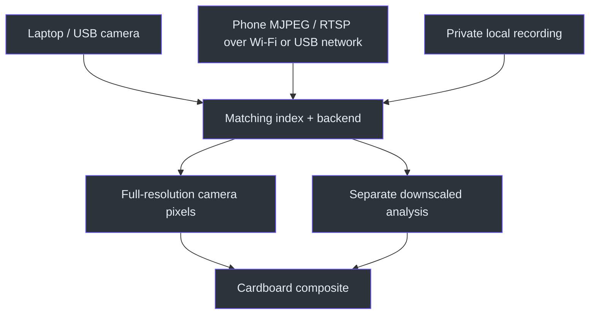
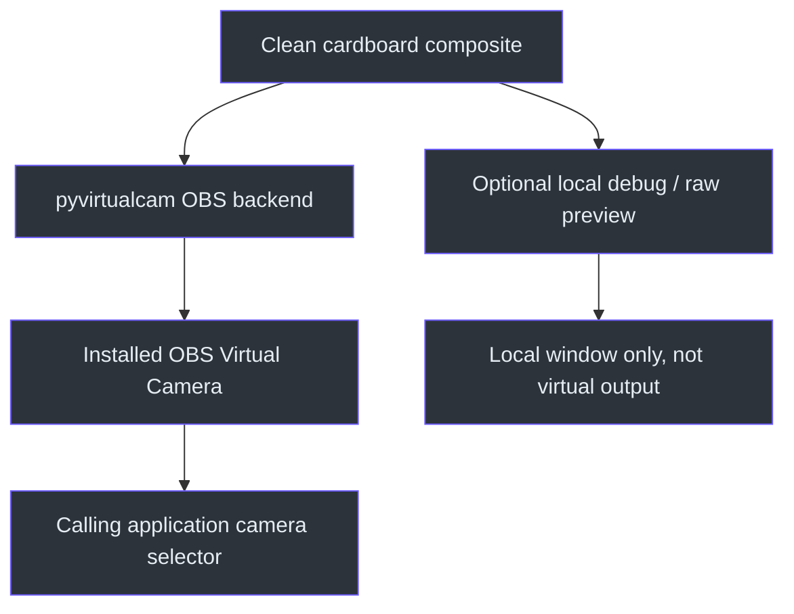

# Camera input and virtual output

[Visual home](../../README.md) · [Getting started](getting-started.md) ·
[Features and controls](features-and-controls.md)

Camera **input** supplies pixels to KardboardCode. Virtual-camera **output** sends the composed
cardboard image to another application. They are separate resources; never select OBS Virtual
Camera as input while sending to that same output
(`src/kardboard_vtuber/cli.py:377-502`;
`src/kardboard_vtuber/virtual_camera.py:28-57`).

## Laptop / USB camera

In Studio choose **Camera → Input type → This computer's camera → Refresh**, select a named
device, then press **Start camera**. Enumeration uses Windows metadata without opening a stream.
Each selection preserves the API/index pair; the same physical camera can appear under MSMF and
DirectShow (`src/kardboard_vtuber/camera/devices.py:12-56`).

Refresh/reselect after hardware changes. If a previously named choice disappears, Studio clears
it rather than silently switching cameras. Manual numeric sources still exist, but `0` is not
guaranteed to be the laptop camera on every machine
(`docs/09-desktop-studio/tutorial.md:43-61`).

For a basic **unmasked capture probe**, the CLI still supports:

```powershell
.\.venv312\Scripts\python.exe -m kardboard_vtuber --source 0 --backend auto --mirror
```

That command deliberately does not enable cardboard. For the avatar, add `--physics` or
`--render-cardboard` after verifying the face model. Q or Escape exits the CLI preview.

## Phone stream / recording / manual source

Choose **Phone stream / video file / manual source** in Studio. Direct phone-hosted MJPEG/RTSP
works over Wi-Fi or Android USB-tethered networking, without a vendor Windows camera client.
Do not assume the phone exposes native USB UVC webcam mode.

Set the source before launching from the **same terminal**:

```powershell
$env:KARDBOARD_CAMERA_URL = Read-Host "Paste your full camera stream URL"
.\.venv312\Scripts\python.exe -m kardboard_vtuber.gui
```

Or run a cardboard CLI session:

```powershell
.\.venv312\Scripts\python.exe -m kardboard_vtuber `
  --source $env:KARDBOARD_CAMERA_URL `
  --backend auto `
  --mirror `
  --physics `
  --tracking-width 1280 `
  --brightness 30
```

Use `--rotate left`, `--rotate right`, `--rotate 180` or `--rotate none` to match the actual
placement. A sideways portrait phone setup previously needed `--rotate left`; that is not a
universal recommendation. For an already mirrored recording, use `--input-already-mirrored`
instead of mirroring twice. Local recordings can be browsed as sources for offline testing.

Do not commit authenticated URLs. Diagnostic redaction is implemented, but source values must
remain private. An environment assignment in a different terminal does not populate this one
(`src/kardboard_vtuber/runtime.py:19-31`;
`src/kardboard_vtuber/gui/settings.py:30-38`).



## Use as a camera in Discord, Teams or Meet

On Windows, install OBS Studio once with its **OBS Virtual Camera** component. Install the
optional sender dependency if it is not already present:

```powershell
.\.venv312\Scripts\python.exe -m pip install -e ".[tracking,virtual-camera]"
```

Enable **Send clean video to OBS Virtual Camera** in Studio's **Output & effects**, or run:

```powershell
.\.venv312\Scripts\python.exe -m kardboard_vtuber `
  --source $env:KARDBOARD_CAMERA_URL `
  --mirror `
  --physics `
  --tracking-width 1280 `
  --brightness 30 `
  --virtual-camera
```

Select **OBS Virtual Camera** in the calling application. OBS itself may remain closed:
Python writes to its installed component. Only one producer can own it; stop OBS's own
virtual-camera sender and any competing process. This does not install a custom KardboardCode
device. App permissions and organizational policies can restrict virtual cameras
(`src/kardboard_vtuber/virtual_camera.py:31-57`).

For **OBS Window Capture**, use the separate **KardboardCode - Clean Output** window, opened by
default from Live/demo. Select its client area rather than capturing the Studio with private
diagnostic panels. This window is independent of the virtual-camera sender.
Use **Show clean output** beside the Live preview, or the same View action, to reopen it after
closing it without stopping/restarting the session. **Auto-open** separately controls startup
opening; manual reopening works when it is off. Idle opening is black and starts no camera.
Raw/headless/Video states cannot display clean output.



`--virtual-camera` enables face tracking/cardboard automatically. Face-only output starts black
before acquisition, then freezes the last-safe composite on loss/staleness. Local text, face-mesh
insets and even `--debug-face-preview` are applied after export and do not enter the virtual feed.
Processing brightness also stays internal (`src/kardboard_vtuber/cli.py:624-685`).

### Format, audio and headless use

- Defaults: 1280x720 at an **advertised** 30 FPS; actual motion throughput depends on input
  and tracking. The image is aspect-fitted with black bars, not stretched or cropped.
- `--virtual-camera-width` / `--virtual-camera-height` require positive even dimensions.
  `--virtual-camera-fps` accepts finite values from 1 to 60. These differ from requested
  capture width/height/FPS and local `--preview-height`.
- The GUI uses standard SD/HD/FHD/QHD/4K/portrait and current-display presets instead of unit
  spin boxes. Video-file exports retain source dimensions instead of these live output sizes.
- Add `--headless` for no CLI preview windows; rendering/output continue. Ctrl+C stops and
  releases the device. Studio's equivalent suppresses preview transfer, not its controls/logs.
- Video only: select the microphone separately. OBS Window Capture remains a separate option
  when not using direct output.

Source: `src/kardboard_vtuber/virtual_camera.py:13-25,68-109`.
Backend reference: [pyvirtualcam supported cameras](https://github.com/letmaik/pyvirtualcam#supported-virtual-cameras).

## Troubleshooting and known limits

| Symptom | Check first |
|---|---|
| Empty source | Set it in this same terminal or enter it in Studio |
| Wrong device | Refresh and choose the matching name/backend/index |
| Sideways / mirrored twice | Correct rotation; use already-mirrored recording semantics |
| Frozen output | Face visibility, framing and lighting; do not disable safe loss handling |
| Missing model | Explicitly verify/download the model for the enabled feature |
| Virtual camera cannot open | Installed component, competing sender, calling-app permissions |
| Only LIVE controls change | Stop before changing resource topology |
| Invalid eye edit | Each blink threshold must be lower than both open/wink |
| Slow shutdown | Native camera work may still be blocking; cleanup is cooperative |

Reliable distant-face acquisition and actual Discord/Teams/Meet qualification remain unconfirmed.
RGB hand restoration is approximate; arbitrary-object depth occlusion is unsupported.
Private recordings are unmasked, and fixed-FPS writing can distort duration at low delivery FPS.
See [scoped evidence and remaining gaps](../07-quality-and-testing/validation-evidence.md).

## Implementation references

- `pyproject.toml:17-35` — optional GUI/tracking/virtual-camera dependencies.
- `src/kardboard_vtuber/camera/devices.py:12-56` — metadata-only inventory and matching APIs.
- `src/kardboard_vtuber/gui/settings.py:48-140` — input/output controls and source privacy.
- `src/kardboard_vtuber/cli.py:377-685` — resource startup, composition and export order.
- `src/kardboard_vtuber/runtime.py:19-31` — endpoint redaction.
- `src/kardboard_vtuber/virtual_camera.py:13-109` — format checks, frame ownership and transport.
