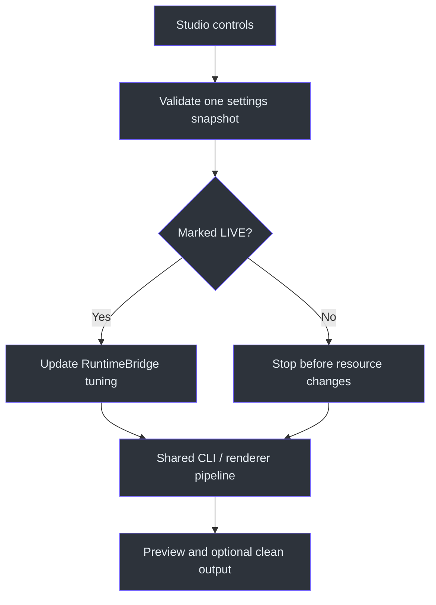
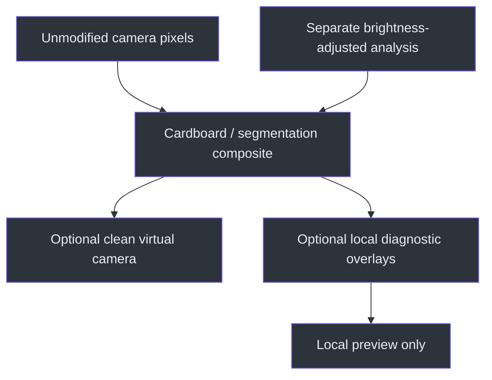

# Features and controls

[Visual home](../../README.md) · [Getting started](getting-started.md) ·
[Camera and virtual output](camera-and-virtual-output.md)

Studio is the visual control surface for the existing CLI pipeline, not a second renderer.
It exposes all 45 current runtime options, plus model and private-recording actions. See the
[complete control inventory](../09-desktop-studio/interface-specification.md).
Sources: `src/kardboard_vtuber/gui/settings.py:48-186`;
`src/kardboard_vtuber/cli.py:40-298`.

## Current capabilities

| Area | Included behavior | Important boundary |
|---|---|---|
| Input | Windows cameras; phone MJPEG/RTSP; USB-tethered phone networking | No Windows vendor camera client is required for a direct phone stream |
| Capture | Latest-frame buffering, reconnect, rotation, mirroring, negotiated diagnostics | Internal post-decode age is not end-to-end latency |
| Face | MediaPipe pose, anatomical blink/wink, One Euro smoothing | Reliable distant-face acquisition remains unresolved |
| Avatar | Real textured ModernGL 3D, hollow underside, corrugation, headphones, aged asymmetric decals | Procedural 2D remains a fallback/comparison |
| Motion | Five optional flap/tab spring hinges | Independent secondary motion, not a full-body simulation |
| Effects | Person-segmentation green screen; conservative hand foreground | RGB does not establish physical object depth |
| Diagnostics | Local face mesh/XYZ/actions/FPS; separate 33-point skeleton | Debug views do not fill a full-body avatar into camera output |
| Output | Installed OBS Virtual Camera component | Video only; not a new KardboardCode-named camera driver |
| Studio | Presets, themes, logs, tutorial, live eye calibration | Sources/raw consent are not saved in presets |

These are implemented features, not universal hardware/performance guarantees. Earlier phone
preview observations were around 28-30 FPS; an isolated renderer measurement was about 8.17 ms
per 1080x1920 frame on AMD Radeon 780M. Neither is a current all-feature benchmark.
See [scoped validation evidence](../07-quality-and-testing/validation-evidence.md).

## Studio pages and live changes

Use **Camera**, **Avatar & eyes**, **Output & effects**, **Tracking labs**, **Private capture**,
**Models** and **Tutorial**. Diagnostics occupy side panels, not the program image.
Logs/CLI-equivalent occupy the bottom tabs.
Left/right blink overrides, shared wink/open/asymmetry thresholds, internal brightness and
debounce are live. Other settings unlock after Stop
(`src/kardboard_vtuber/gui/settings.py:17-29,48-186`).



Guided OPEN/CLOSED calibration derives both eye overrides and compatible shared rules.
Raise blink thresholds for missed closures; lower them for false closures. Raw eye signals
drive rendering while geometry remains filtered. Invalid combinations display **Not applied**
and retain the last valid tuple. Model/source
inspection is deferred from slider callbacks to the worker. Source/log copies are redacted;
native libraries may still write separate stderr (`src/kardboard_vtuber/runtime.py:19-57,102-119`;
`docs/09-desktop-studio/runtime-architecture.md`).

## Eye calibration and action logging

K follows the anatomical left eye; C follows the anatomical right. Enable an independent
override to set a different blink threshold for each. Shared blink is the fallback where an
override is off. Each effective blink threshold must stay below both open and wink thresholds.

For less sensitive CLI eye closure, one example is:

```powershell
--blink-threshold 0.20 `
--wink-threshold 0.50 `
--eye-open-threshold 0.72 `
--wink-min-difference 0.25
```

Lower blink/wink values are less sensitive. Higher opposite-eye openness and minimum
left/right difference also reject more accidental winks. The same rules drive rendered
K/C expressions and action detection (`src/kardboard_vtuber/gui/settings.py:80-111`;
`src/kardboard_vtuber/runtime.py:34-57`).

`--action-hold-ms 100` changes face/mouth transition stability; eye actions have their own
`--eye-action-hold-ms` control. Debounced transitions remain logged without visible diagnostics.
`--no-motion-filter` compares raw motion against the default One Euro smoothing
(`src/kardboard_vtuber/cli.py:40-298`).

## Avatar, physics and framing

- `--render-cardboard` enables face tracking and the textured 3D renderer.
- `--cardboard-renderer procedural-2d` selects the original fallback/comparison; disable
  `--physics` before choosing it.
- `--physics` enables the textured avatar and spring motion for three underside flaps and two
  side tabs. The side tabs respond independently to left/right turns.
- `--box-depth-offset` defaults to `0.16`; `0` restores the previous perspective placement.
  Finite positive values move the box farther away. Excessive values can reduce coverage.
- `--preview-height` changes only local window sizing, not source framing or processing.

The default mesh has real six-sided depth, a neck-safe hollow underside, corrugated cut edges,
chunky headphones, top FRAGILE label, shipping marks and separately torn/stained side labels.
Read the [renderer chapter](../02-architecture/textured-3d-renderer.md) for geometry, material,
lighting, depth and five-hinge details. Source: `src/kardboard_vtuber/cli.py:960-1010`;
`src/kardboard_vtuber/renderer/textured_3d.py:111-327`.

## Clean preview, debug and privacy

`--tracking-debug` adds local face mesh/pose/XYZ/actions/FPS diagnostics. It is off by default.
`--debug-face-preview` intentionally exposes a raw face crop locally and requires explicit
GUI acknowledgement; never enable it casually while screen-sharing. Clean virtual output is
sent before these local overlays (`src/kardboard_vtuber/cli.py:624-685`).



Face-only output is black before safe acquisition, then freezes the last-safe composite on
tracking loss/staleness. Internal `--brightness` affects analysis, not final visible pixels.
Do not treat the failure policy as proof that every detected pose completely masks identity.

## Green screen and hand foreground

Verify/download the segmentation model explicitly, then add `--green-screen`. Person pixels
remain over pure chroma green `(0, 255, 0)` for OBS; before a fresh mask, output is entirely green
(`src/kardboard_vtuber/cli.py:403-412,600-640`).

```powershell
.\.venv312\Scripts\python.exe scripts\download_selfie_segmenter_model.py
.\.venv312\Scripts\python.exe -m kardboard_vtuber `
  --source $env:KARDBOARD_CAMERA_URL `
  --backend auto `
  --rotate left `
  --mirror `
  --physics `
  --green-screen `
  --preview-height 900
```

Set the source in this same terminal first as shown in the [camera guide](camera-and-virtual-output.md).
Use `--rotate left` only for a placement that actually produces a sideways stream.
`--hand-occlusion` restores conservative anatomical hand/forearm regions, not arbitrary objects.
Inferred-depth foreground restoration was removed after privacy failures.

## Tracking labs: experimental, not the chosen default

The selected normal workflow is **face-only with safe-frame freeze**. These options remain
available for deliberate experiments, not as proven replacements:

| Option | Behavior | Caveats |
|---|---|---|
| `--full-body` | Separate 33-point outline/numbered-skeleton window | Diagnostic only; whole-body framing is needed |
| `--body-head-fallback` | Calibrated face-to-shoulder head anchor with neutral expressions | Needs several visible-face observations; no generic uncalibrated size guess |
| `--hood-marker-tracking` | Green anatomical-left / blue anatomical-right squares plus face/body state | Red/pink are not markers; no face/side markers does not prove a rear view |

The two fallback modes cannot be combined (`src/kardboard_vtuber/cli.py:314-316`).
For shoulder calibration, face the camera normally at startup; progress is visible while the
upper region is masked. Low-rate fallback pose inference is bounded to avoid starving capture.
On unreliable references/markers, the existing privacy-safe hold/freeze applies. Side markers
retain recent face/body-derived head size, briefly holding marker motion through occlusion.
See [experimental tracking guidance](../09-desktop-studio/tutorial.md#7-advanced-tracking-and-raw-debug).

## Recording, presets and stopping

Recording saves **unmasked private MP4 + CSV**, not safe avatar output. The fixed-FPS writer can
compress playback duration when delivered capture FPS is lower; this is unresolved.
Reuse private recorded footage for offline regression rather than opening a camera unnecessarily.

Presets retain validated controls, not sources or raw-preview consent. Stop is cooperative;
close waits for the worker rather than forcibly terminating a Qt thread.
See [private-capture tutorial](../09-desktop-studio/tutorial.md#9-advanced-private-capture-and-replay).

Front **VIDEO** mode instead processes an existing file into a new avatar video. It is not raw
capture. It offers lossless MKV and high-quality MP4, retains source size/timing/compatible audio
and processes every frame. See [the video chapter](../09-desktop-studio/video-processing.md).

## Implementation references

- `src/kardboard_vtuber/gui/settings.py:17-186` — control inventory and privacy/live allowlists.
- `src/kardboard_vtuber/runtime.py:19-140` — redacted logs, validated tuning and bounded ownership.
- `src/kardboard_vtuber/cli.py:377-685` — shared pipeline and clean-export order.
- `src/kardboard_vtuber/virtual_camera.py:13-109` — fixed-format output and owned frame.
- `src/kardboard_vtuber/renderer/textured_3d.py:111-327` — default textured avatar.
- `pyproject.toml:6-43` — dependencies and entry points.
