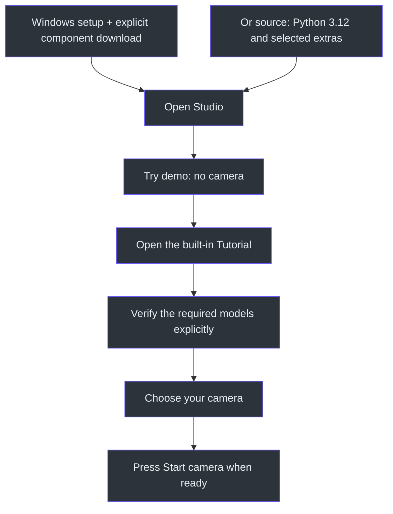
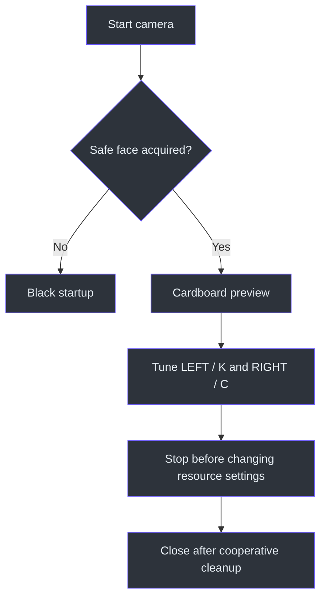

# Getting started

[Visual home](../../README.md) · [Features and controls](features-and-controls.md) ·
[Camera and virtual output](camera-and-virtual-output.md)

This is the operating information moved out of the visual front README. Start with the native
Studio; the CLI remains available. Choose the online Windows setup for normal use or the
source ZIP for development. Python 3.11+ is the source-package floor; Python 3.12 is the
established tracking environment.

## Windows setup: no manual Python

1. Download [KardboardCode-Studio-windows-x64.msi](../../release/KardboardCode-Studio-windows-x64.msi).
2. Install for your Windows account, then open **KardboardCode Studio** from Start.
3. Choose **Install components** in the first-launch window. Internet is required; wait until
   the verified downloads finish and Studio opens. Failure is explicit and can be retried.
4. Choose **Try demo**, then follow **Tutorial**. Download needed AI models explicitly in Models.

The MSI includes patched private Python; it does not change system Python or PATH. It is an
**online, unsigned Windows x64** setup, not an offline package. It targets Windows 10/11 with
an OpenGL 3.3-capable graphics driver. Verified HTTPS package mirrors are supported; bypassing
TLS or device policy is not. Models, cameras and OBS components never start/install here.
See [installation architecture and troubleshooting](../09-desktop-studio/windows-installation.md).

## Source checkout / source ZIP

Extract the source package or open your checkout, then run in its project root:

```powershell
py -3.12 -m venv .venv312
.\.venv312\Scripts\python.exe -m pip install -e ".[tracking,virtual-camera,gui]"
.\.venv312\Scripts\python.exe -m kardboard_vtuber.gui
```

After installation, `.\.venv312\Scripts\kardboard-studio.exe` is the desktop launcher.
For contributors, install `".[dev,tracking,virtual-camera,gui]"` instead. For basic CLI-only
capture, Python 3.11+ and the base package are sufficient; omit the optional GUI/tracking extras.
The entry points and optional dependencies are declared in `pyproject.toml:17-43`.

Opening Studio does not start capture. Click **Try demo** for a camera-free stage, or launch:

```powershell
.\.venv312\Scripts\python.exe -m kardboard_vtuber.gui --demo
```

The demo uses the real renderer with synthetic tracking. It does not open a camera, run live
inference, record or publish virtual-camera output. **Tutorial** opens the in-app walkthrough
(`src/kardboard_vtuber/gui/__init__.py:11-71`;
`docs/09-desktop-studio/tutorial.md:19-35`).



## Verify models

Stop the demo and use **Models → Verify / download**. Verification checks the expected hash;
downloads happen only through this explicit action. A normal face-only session needs the Face
Landmarker; body, hand and background effects have their own models. Models are not bundled in
the release (`docs/09-desktop-studio/tutorial.md:37-43`;
`src/kardboard_vtuber/gui/settings.py:145-186`).

The existing command-line download helpers remain available:

```powershell
.\.venv312\Scripts\python.exe scripts\download_face_landmarker_model.py
.\.venv312\Scripts\python.exe scripts\download_pose_landmarker_model.py
.\.venv312\Scripts\python.exe scripts\download_hand_landmarker_model.py
.\.venv312\Scripts\python.exe scripts\download_selfie_segmenter_model.py
```

Run only the helpers needed for the features you intend to use.

## Choose an input

For a laptop/USB camera: **Camera → This computer's camera → Refresh → named device**.
Listing metadata does not open a stream. Each named choice keeps its matching capture
backend/index; the same device may appear under Media Foundation and DirectShow. Index `0`
is not a universal laptop-camera identity (`src/kardboard_vtuber/camera/devices.py:12-56`).

For a phone URL or recording, choose **Phone stream / video file / manual source**.
The [camera guide](camera-and-virtual-output.md) explains rotation, sources, output and
same-terminal environment setup. Do not recover old credentials from history.

## Start, tune, stop

Choose **LIVE**, then press **Start camera**. Face-only cardboard begins black before acquisition and freezes the
last-safe composite on face loss. This is a failure policy, not proof of perfect masking for
every detected angle (`src/kardboard_vtuber/cli.py:377-648`).

In **Avatar & eyes**, use **Calibrate OPEN / CLOSED eyes** to measure both phases. Tune anatomical
**LEFT / K** and **RIGHT / C** independently. Raise blink thresholds for missed closures; lower
them for false closures. **LIVE** fields update during a live session; other settings dim,
show LOCKED and unlock after **Stop**
(`src/kardboard_vtuber/gui/settings.py:17-29,80-111`;
`src/kardboard_vtuber/runtime.py:34-57,102-108`).



For the full walkthrough, use the [Studio tutorial](../09-desktop-studio/tutorial.md).
Presets exclude camera sources and raw-face consent; private recording saves unmasked footage.
Those are deliberate safety boundaries, not missing convenience features.

## Process an existing video

Choose the front **VIDEO** mode, browse the input and a new output filename, configure avatar/eyes
and press **Process video**. Default lossless MKV preserves processed RGB without added
compression loss; high-quality MP4 is a smaller, explicitly lossy alternative. Source dimensions,
timestamp spacing within container precision and compatible audio are retained. Every frame is
processed; no live camera opens. See [video processing](../09-desktop-studio/video-processing.md).

For OBS Window Capture, use the separate **KardboardCode - Clean Output** window in Live mode,
not the Studio's private diagnostics. It is different from OBS Virtual Camera.

## Release and deeper reading

- [Release files, regeneration and manual publication](../../release/README.md).
- [Feature flags, tuning and experimental modes](features-and-controls.md).
- [Camera input, OBS Virtual Camera and troubleshooting](camera-and-virtual-output.md).
- [Engineering book and source maps](../README.md).
- [Original PNGTuber Plus layers and behavior](../../assets/PNGTuberV1/README.md).

## Implementation references

The source-grounded paths above cover package setup (`pyproject.toml`), the launcher
(`gui/__init__.py`), control declarations (`gui/settings.py`), metadata-only inventory
(`camera/devices.py`), shared execution (`cli.py`) and live ownership (`runtime.py`).
